# Лабораторная работа №3. Облачные сети. Amazon VPC

Подготовил: Kirov Kiril IA-2404

# Часть  1. Базовый уровень

## Задание 1. План адресов

Таблица маршрутов для варианта 7

| Подсеть | Зона доступности | Диапазон | Первый и последний адрес, доступный экземплярам | Сколько адресов доступно экземплярам |
| --- | --- | --- | --- | --- |
| **public-a** | `eu-central-1a` | `10.7.0.0/24` | `10.7.0.4` — `10.7.0.254` | 251 |
| **public-b** | `eu-central-1b` | `10.7.1.0/24` | `10.7.1.4` — `10.7.1.254` | 251 |
| **private-a** | `eu-central-1a` | `10.7.10.0/24` | `10.7.10.4` — `10.7.10.254` | 251 |
| **private-b** | `eu-central-1b` | `10.7.11.0/24` | `10.7.11.4` — `10.7.11.254` | 251 |

    ## 1. Почему доступных IP-адресов не 256?

Подсеть `10.X.0.0/24` содержит:

\\[ 2^{32-24}=2^8=256 \\]

Однако AWS резервирует 5 IP-адресов в каждой подсети IPv4, поэтому пользователю доступны:

\\[ 256-5=\boxed{251\text{ IP-адрес}} \\]

## 2. Какие адреса занимает AWS и для чего?

Для подсети `10.X.0.0/24`:

| IP-адрес     | Назначение                                    |
| ------------ | --------------------------------------------- |
| `10.X.0.0`   | Адрес сети (Network Address)                  |
| `10.X.0.1`   | Зарезервирован для маршрутизатора VPC         |
| `10.X.0.2`   | Зарезервирован для DNS-сервера AWS            |
| `10.X.0.3`   | Зарезервирован AWS для будущего использования |
| `10.X.0.255` | Последний адрес подсети, зарезервирован AWS   |

Диапазон доступных адресов: `10.X.0.4 – 10.X.0.254`.

## 3. Сколько ещё подсетей /24 поместится в VPC?

Количество зависит от размера CIDR-блока вашей VPC.

Если VPC имеет адресное пространство `10.X.0.0/16`, то:

\\[ 2^{24-16}=2^8=256 \\]

Таким образом, в VPC `/16` можно создать 256 подсетей `/24`.

Если одна подсеть `10.X.0.0/24` уже создана:

\\[ 256-1=\boxed{255\text{ подсетей}} \\]

Это теоретическое количество по адресному пространству. На практике AWS также устанавливает квоты на число подсетей в VPC.

Итог: В подсети `/24` доступен 251 IP-адрес, поскольку 5 резервирует AWS. Если VPC имеет маску `/16`, в ней можно разместить ещё 255 подсетей `/24`, при условии отсутствия других занятых диапазонов и достаточных квот.

## Задание 2. VPC и подсети

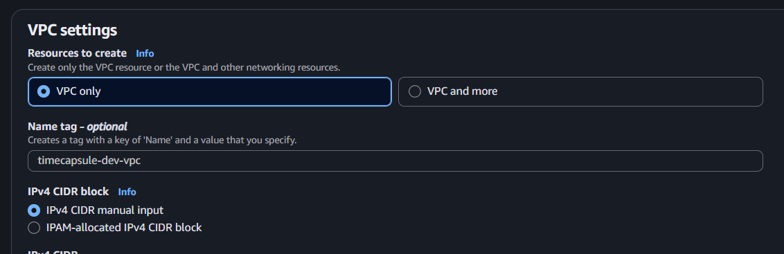

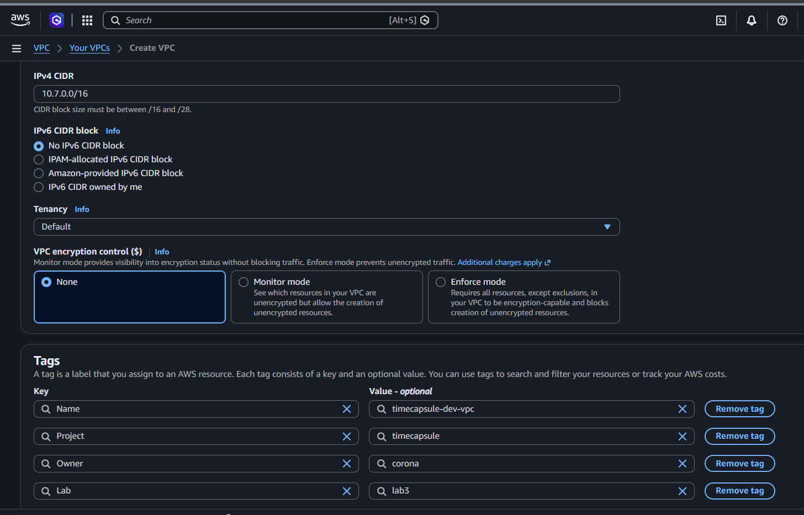

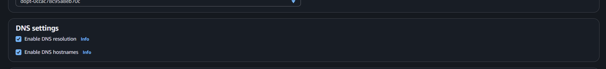

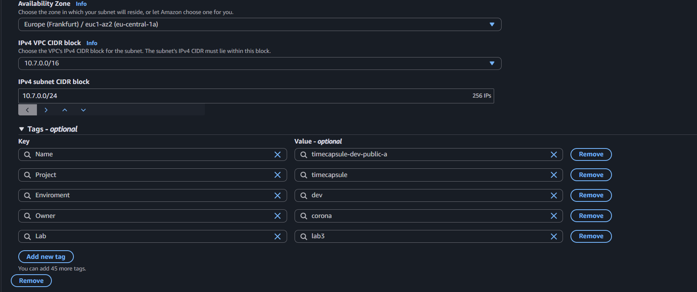

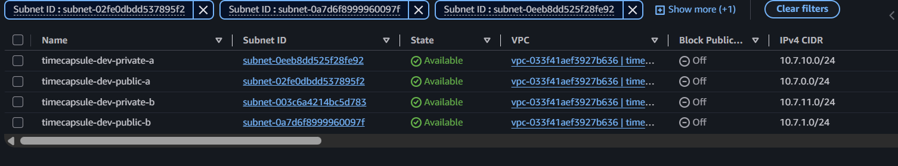

Нет, подсеть `public-a` пока не является публичной, несмотря на название.
Причина: к VPC ещё не подключён Internet Gateway, а в таблице маршрутизации отсутствует маршрут 0.0.0.0/0 через него.
Чтобы подсеть стала публичной, необходимо подключить Internet Gateway и настроить маршрут к нему.

## Задание 3. Internet Gateway и таблицы маршрутов

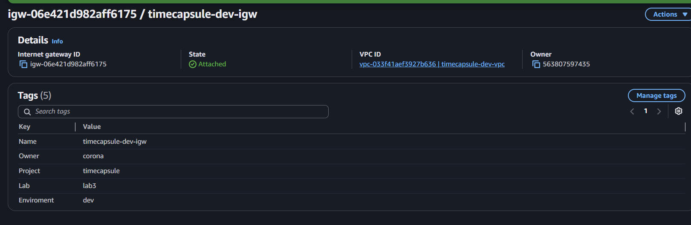

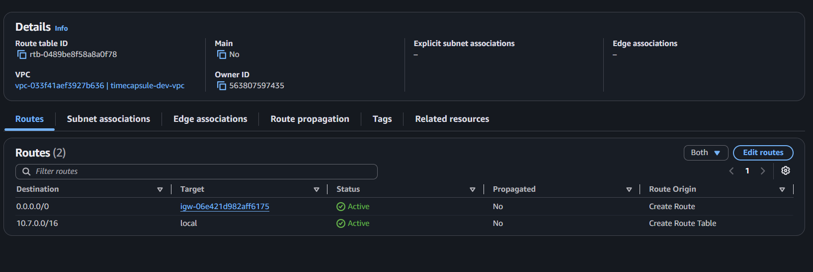

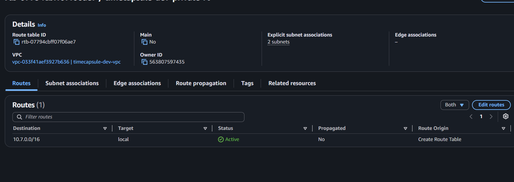

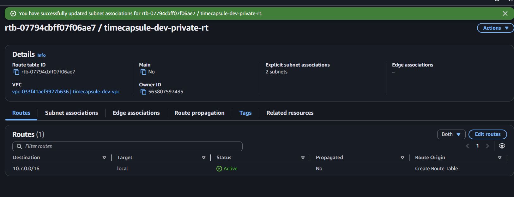

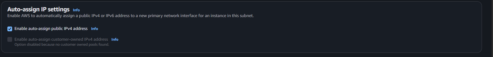


## Задание 4. Security Group

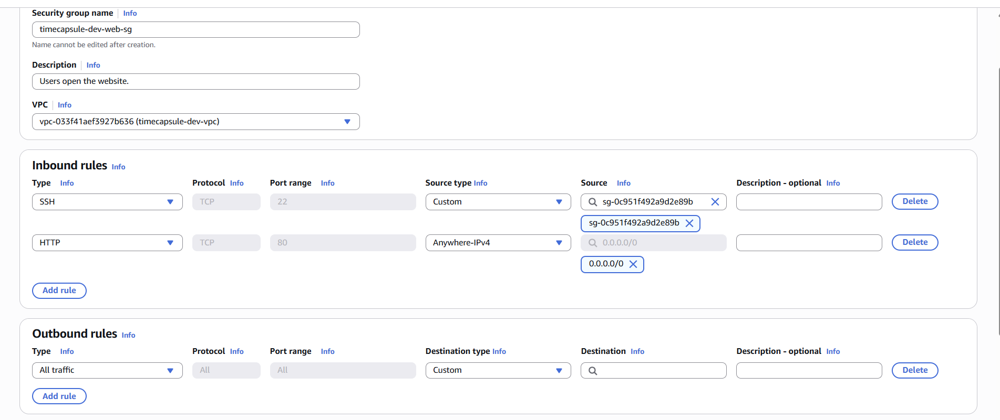

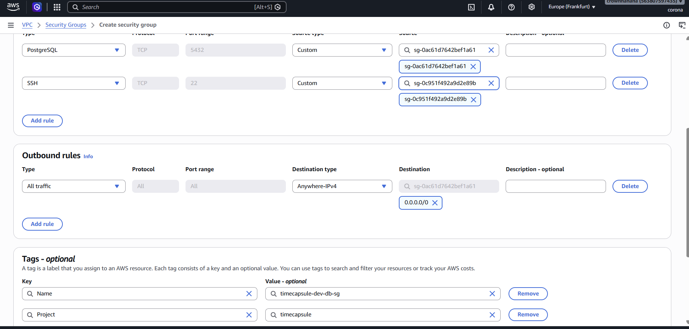

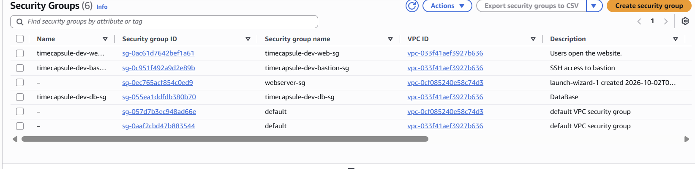


    Почему в db-sg источником указана группа web-sg, а не адрес веб-сервера или диапазон 10.X.0.0/16?

В db-sg источником указывается web-sg, потому что это обеспечивает более безопасный и гибкий контроль доступа к базе данных.

### Почему лучше web-sg?

1. **Безопасность**. К базе данных могут обращаться только EC2-инстансы, использующие web-sg, по разрешённому порту.
2. **Гибкость**. Если IP веб-сервера изменится, правило продолжит работать.
3. **Масштабируемость**. Если добавить второй веб-сервер с той же Security Group, он автоматически получит доступ к базе данных.

## Задание 5. Экземпляры

| Роль       | Имя в консоли           | Подсеть   | Публичный IP | Security Group |
|------------|-------------------------|-----------|--------------|----------------|
| bastion    | timecapsule-dev-bastion  | public-b  | Enable       | bastion-sg     |
| web-server | timecapsule-dev-web      | public-a  | Enable       | web-sg         |
| db-server  | timecapsule-dev-db       | private-a | Disable      | db-sg          |

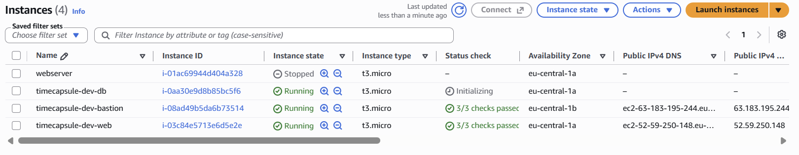

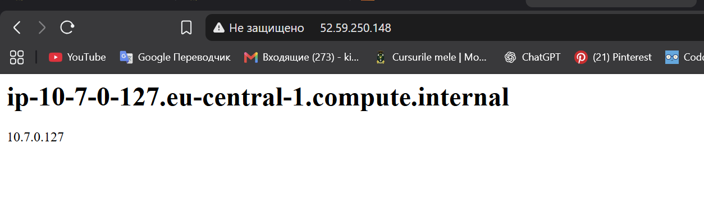

```yml
Host bastion
   HostName 63.183.195.244
   User ec2-user
   IdentityFile ~/.ssh/corona-keypair.pem

Host web
   HostName 10.7.0.127
   User ec2-user
   IdentityFile ~/.ssh/corona-keypair.pem
   ProxyJump bastion

Host db
   HostName 10.7.10.151
   User ec2-user
   IdentityFile ~/.ssh/corona-keypair.pem
   ProxyJump bastion
```

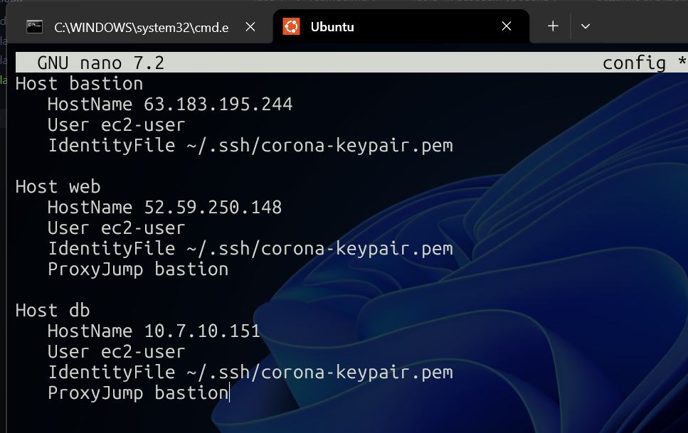

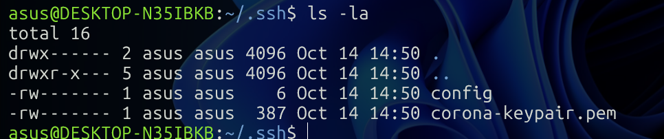

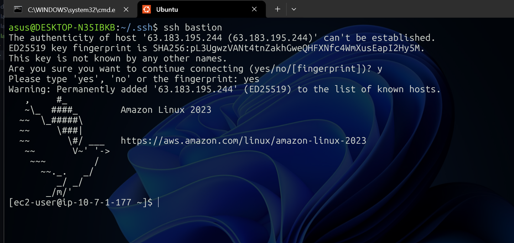

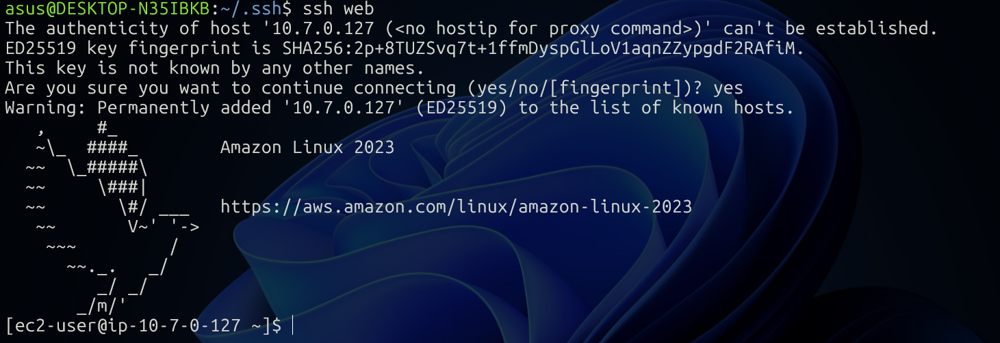

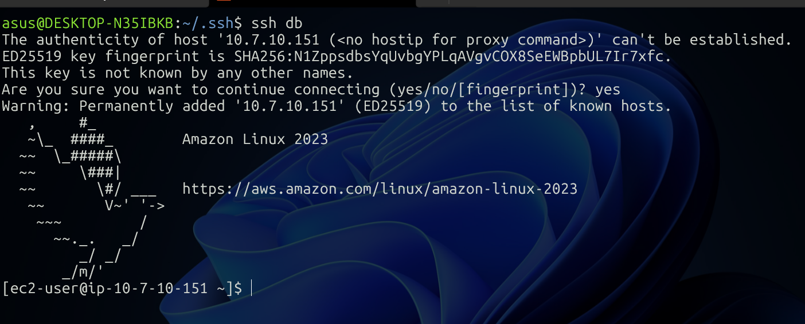

    Почему db-server не может скачать пакеты, хотя web-server это делает? Что нужно добавить в сеть, чтобы это стало возможно, и при этом db-server остался недоступным из интернета?

db-server не может скачивать пакеты, потому что находится в приватной подсети (Private Subnet), у него нет публичного IP-адреса и маршрута для выхода в интернет.
В отличие от него, web-server находится в публичной подсети (Public Subnet), имеет публичный IP и использует Internet Gateway (IGW) для доступа в интернет.
Что нужно добавить?
Необходимо создать NAT Gateway (Network Address Translation Gateway).

## Задание 6. Временный NAT Gateway

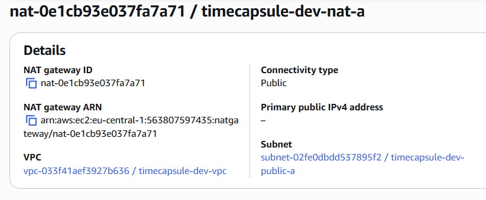

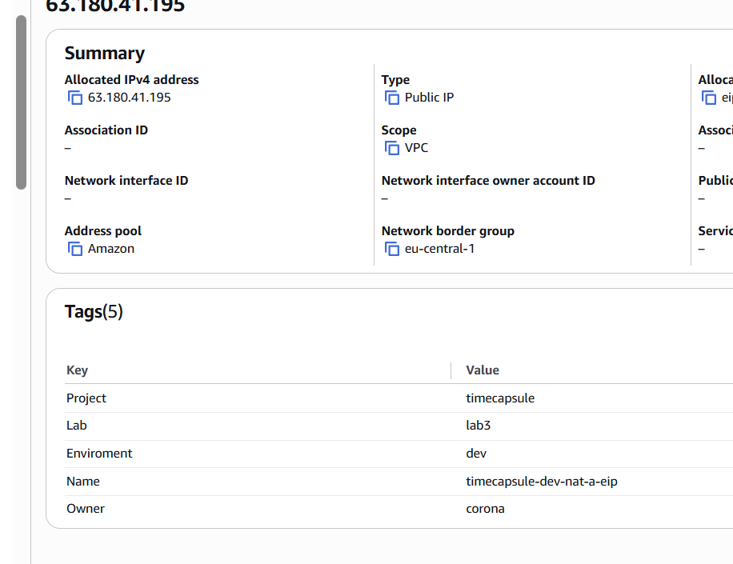

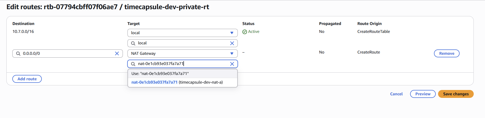

```cs
[ec2-user@ip-10-7-10-151 ~]$ sudo dnf -y update
Last metadata expiration check: 0:04:01 ago on Wed Oct 14 13:03:30 2026.
Dependencies resolved.
Nothing to do.
Complete!
[ec2-user@ip-10-7-10-151 ~]$ sudo dnf -y install postgresql16-server
Last metadata expiration check: 0:04:16 ago on Wed Oct 14 13:03:30 2026.
Package postgresql16-server-16.15-1.amzn2023.0.1.x86_64 is already installed.
Dependencies resolved.
Nothing to do.
Complete!
```
Первая команда вернула публичный IP-адрес 63.180.41.195 NAT GateWay.

    Почему это не IP-адрес db-server?

db-server находится в приватной подсети и не имеет собственного публичного IP-адреса. 

Когда сервер отправляет запрос в интернет, NAT Gateway выполняет трансляцию сетевых адресов (SNAT), заменяя приватный IP сервера своим публичным Elastic IP.

Таким образом, внешние сервисы видят адрес 63.180.41.195, а не приватный адрес db-server.

    Доступ к базе теперь ограничивают три механизма: отсутствие публичного адреса и маршрута в Internet Gateway, Security Group db-sg и файл pg_hba.conf. Что делает каждый из них? Что произойдёт, если ошибиться только в одном?

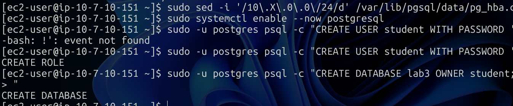

Доступ к базе данных PostgreSQL ограничивается тремя уровнями безопасности:
1. Отсутствие публичного IP и маршрута через Internet Gateway — обеспечивает сетевую изоляцию db-server. Сервер недоступен для прямых подключений из интернета, но может обращаться к внешним ресурсам через NAT Gateway.

2. Security Group (db-sg) — работает как сетевой брандмауэр AWS. Разрешает подключения к PostgreSQL на порту 5432 только от серверов с web-sg, а SSH на порту 22 — от bastion-sg. Остальные входящие соединения блокируются.

3. Файл pg_hba.conf — управляет доступом непосредственно в PostgreSQL. Определяет, с каких IP-адресов разрешены подключения, к каким базам и пользователям, а также какой метод аутентификации применяется, например scram-sha-256.

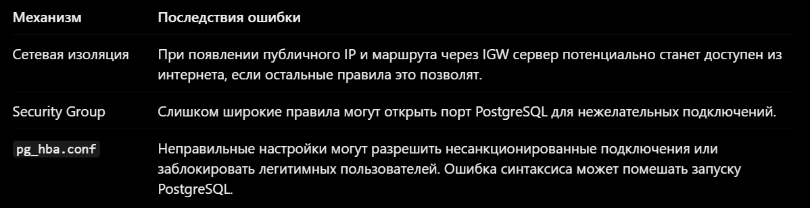

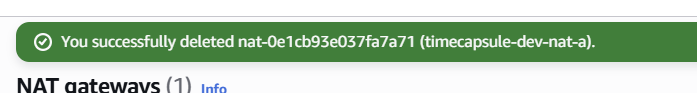


    Почему PostgreSQL продолжает работать после удаления NAT Gateway? Что придётся сделать, когда на db-server понадобится установить обновления безопасности?

`PostgreSQL` продолжает работать после удаления NAT Gateway, потому что NAT Gateway обеспечивает только исходящий доступ в интернет и не влияет на работу уже установленного программного обеспечения. 

`PostgreSQL` работает локально на db-server, а взаимодействие с web-server происходит через внутреннюю сеть VPC по локальным маршрутам.

Для установки обновлений безопасности потребуется временно восстановить доступ в интернет: создать NAT Gateway в публичной подсети, назначить ему Elastic IP и добавить маршрут`0.0.0.0/0` через NAT Gateway в таблицу маршрутизации приватной подсети.

После этого можно выполнить:

```bash
sudo dnf update -y
```

## Задание 7. Проверки

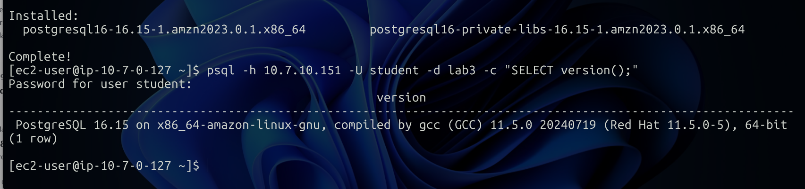

WEB:

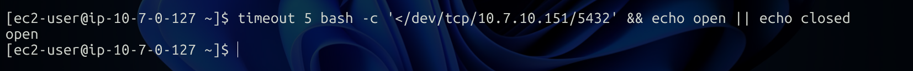

BASTION:

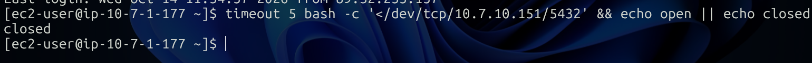

    Почему с web-server порт открыт, а с bastion нет, хотя оба сервера в одной VPC и маршрут между ними есть?

Порт `PostgreSQL (5432)` открыт с `web-server`, но закрыт с `bastion`, потому что в Security Group db-sg разрешены подключения к этому порту только от серверов, использующих `web-sg`.
Хотя оба сервера находятся в одной VPC и между ними существует маршрут, маршрутизация и разрешение доступа — разные механизмы.

- Route Table определяет, куда направлять сетевые пакеты.
- Security Group определяет, какие соединения разрешены.
- pg_hba.conf дополнительно контролирует доступ к PostgreSQL после установления сетевого соединения.

    Почему запрос не проходит? Можно ли из интернета подключиться к порту 5432 db-server? Объясните по цепочке из лекции: маршрут, адрес, фильтры.

Запрос `curl -m 5 https://github.com` с `db-server` не проходит, потому что сервер находится в приватной подсети, а `NAT Gateway` был удалён. Следовательно, у сервера отсутствует маршрут для выхода в интернет.

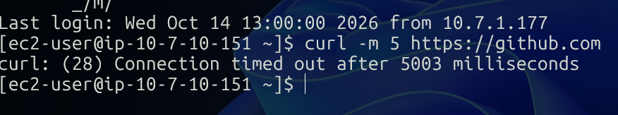


1. Маршрут (Route Table). В приватной подсети отсутствует действующий маршрут 0.0.0.0/0 через NAT Gateway или Internet Gateway. Поэтому пакеты к GitHub не могут выйти за пределы VPC.
2. Адрес (IP Address). db-server имеет только приватный IP-адрес, например 10.7.10.151. Такой адрес не маршрутизируется в публичном интернете. Без NAT Gateway сервер не может использовать публичный IP для исходящих соединений.
3. Фильтры (Security Group). Группа db-sg разрешает подключения к PostgreSQL на порту 5432 только от серверов с web-sg. Подключения из интернета блокируются. Дополнительно pg_hba.conf ограничивает доступ к самой базе данных.

Узнайте свой внешний адрес: он указан в правиле bastion-sg или на странице https://checkip.amazonaws.com.

`89.32.255.157`

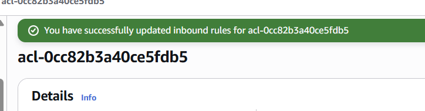

теперь ssh bastion и web browser page не работают

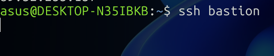

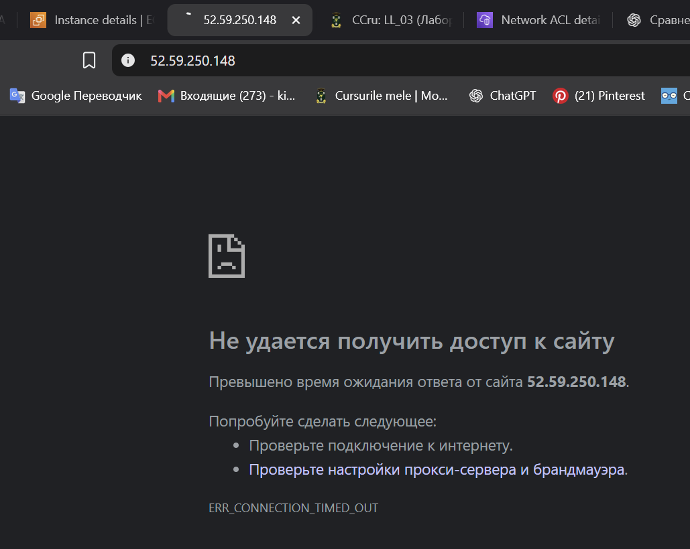


удалил RULE 90 и теперь все опять работает

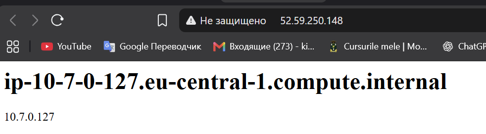

    Почему заблокировано и SSH, и сайт, хотя вы не меняли   

Network ACL фильтрует трафик на уровне подсети, до его обработки Security Group. Правило 90 с действием Deny запрещает весь входящий трафик с моего публичного IP-адреса, независимо от порта и протокола.

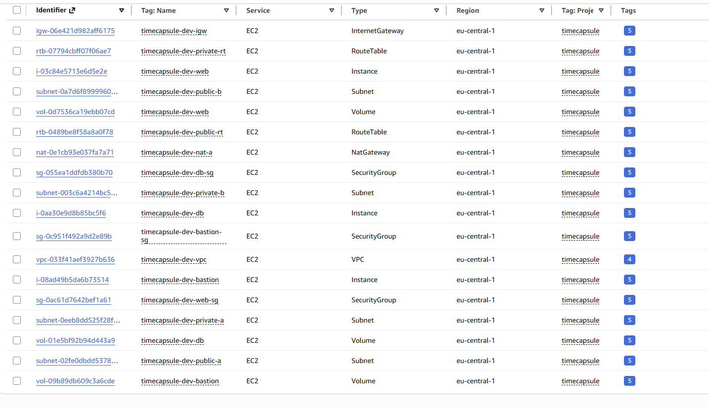

    Как по тегам найти все ресурсы для удаления?
В AWS необходимо открыть Resource Groups → Tag Editor (или Resource Explorer, если он настроен), выбрать нужные регионы и отфильтровать ресурсы по тегам:
- Project = TimeCapsule — все ресурсы проекта.
- Environment = dev — ресурсы среды разработки.
- Lab — ресурсы конкретной лабораторной работы.
- Owner — ресурсы определённого владельца.
Таким образом можно найти связанные с проектом EC2-инстансы, VPC, подсети, Security Groups, NAT Gateway, Elastic IP и другие ресурсы, поддерживающие теги.

2. Зачем нужен тег Owner, если аккаунт личный?
Тег Owner указывает ответственного за ресурс независимо от того, кому принадлежит AWS-аккаунт.
Он полезен по нескольким причинам:
1. Ответственность — позволяет определить, кто создал ресурс и отвечает за его обслуживание.
2. Масштабируемость — если в будущем аккаунт станет общим, ресурсы уже будут распределены по владельцам.
3. Контроль расходов — помогает анализировать затраты на ресурсы разных пользователей или проектов.
4. Автоматизация — позволяет создавать скрипты для поиска, проверки и удаления ресурсов конкретного владельца.

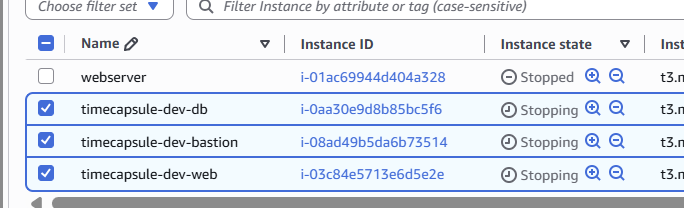

# Часть 2. Продвинутый уровень

## Задание 8. Перенос сервера ЛР2 в новую сеть

Обновил host-name

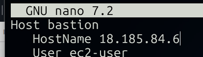

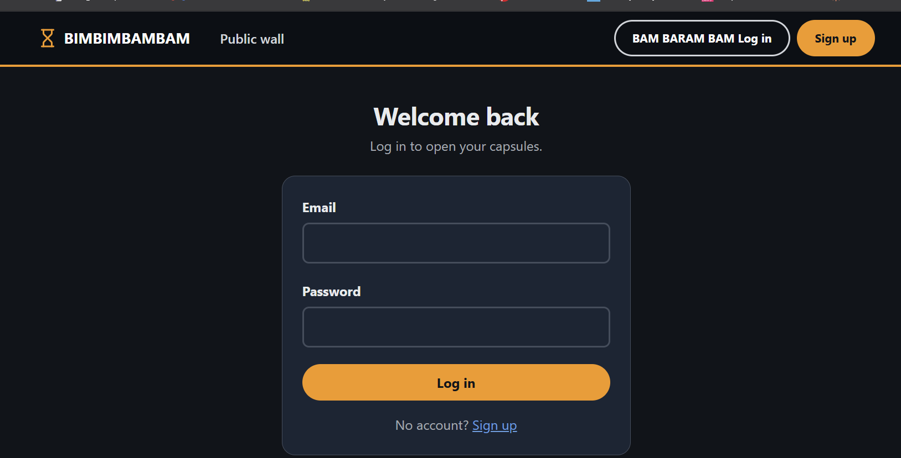

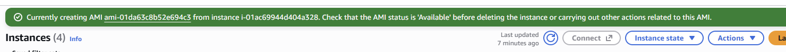

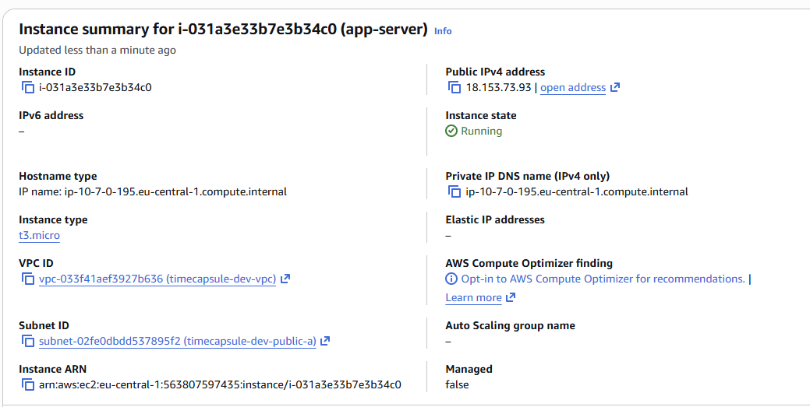

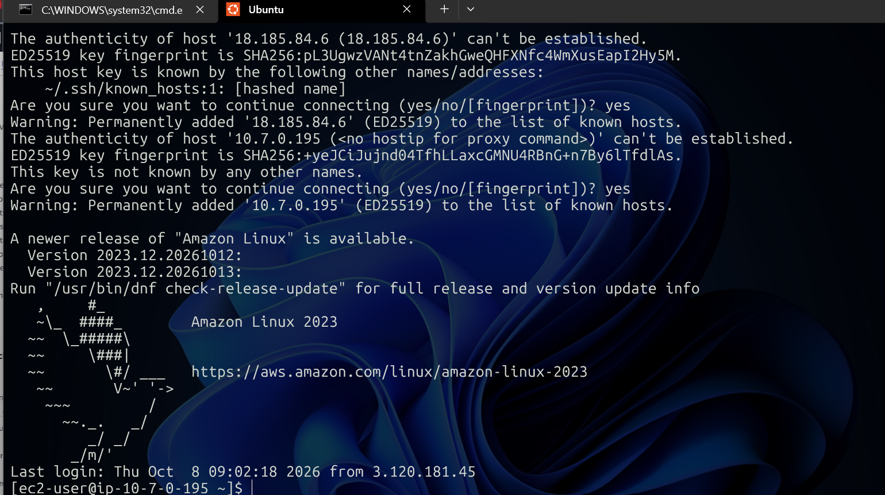

Образ AMI (Amazon Machine Image) содержит состояние EC2-инстанса на момент создания: операционную систему, установленные программы, настройки, файлы приложения и данные на дисках, включённых в образ.

3. Где сейчас хранится база данных приложения?

PostgreSQL также должен был попасть в образ вместе с остальными данными на включённых дисках.

## Задание 9. Elastic IP

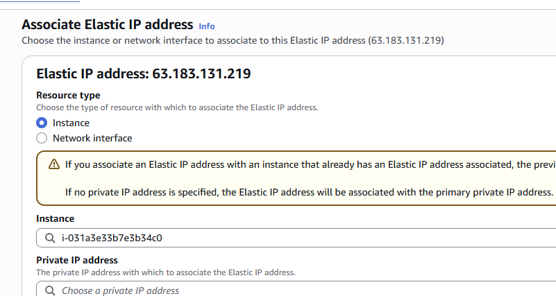

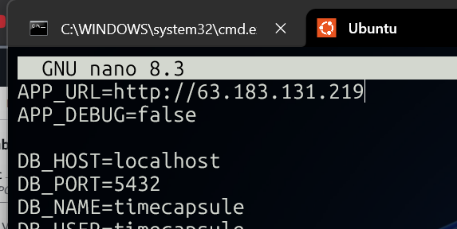

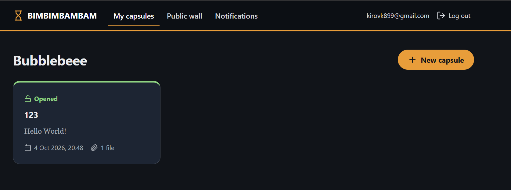

    1. Почему Elastic IP нужен app-server, но не нужен bastion?

Elastic IP — это статический публичный IPv4-адрес AWS, который сохраняется за вашим аккаунтом и может быть переназначен другому серверу.

- app-server — сервер приложения, к которому пользователи должны обращаться по постоянному адресу. Elastic IP позволяет сохранить один IP даже после остановки и повторного запуска EC2.

- bastion — промежуточный сервер для безопасного SSH-доступа. Обычно используется только администратором, поэтому постоянный публичный IP не обязателен.

При необходимости новый адрес можно узнать через AWS Console.

Важно: если доступ к bastion ограничен Security Group конкретным IP администратора, изменение публичного IP самого bastion не влияет на это правило.

2. Сколько стоит Elastic IP, пока сервер остановлен, и почему?

По действующей модели тарификации AWS публичные IPv4-адреса платные независимо от того, работает EC2 или остановлен.
Стоимость одного Elastic IP

- **$0.005** В час

- **$0.12** За 24 часа

- **$3.60** За 30 дней


Причина — публичные IPv4-адреса ограничены, и AWS стимулирует освобождать неиспользуемые адреса. Даже после остановки EC2 Elastic IP остаётся зарезервированным за аккаунтом. 

    3. Понадобится ли Elastic IP после добавления балансировщика нагрузки?

Для самого app-server — обычно нет. Пользователи будут обращаться к балансировщику, а он перенаправит запросы на серверы по их приватным IP-адресам.

Application Load Balancer (ALB) — для обычного веб-приложения достаточно DNS-имени балансировщика, собственный Elastic IP не требуется.

Network Load Balancer (NLB) — можно назначить Elastic IP для каждой используемой зоны доступности, если нужны фиксированные публичные адреса.

## Задание 10. База данных приложения на db-server

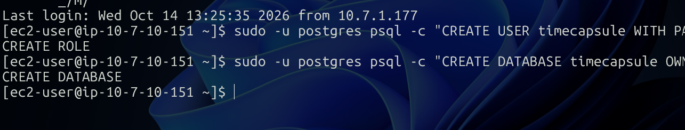

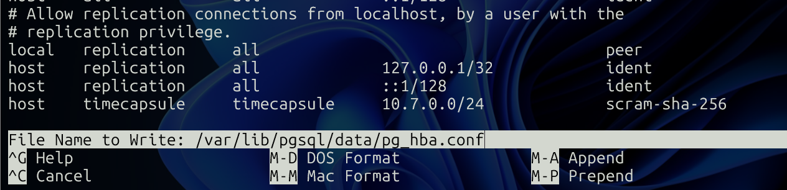

    Зачем для базы в отдельной сети нужен новый сильный пароль, если порт 5432 и так закрыт Security Group?

Новый сильный пароль необходим для реализации принципа многоуровневой защиты (Defense in Depth).
Security Group и пароль PostgreSQL защищают базу данных на разных уровнях:

- Security Group — ограничивает сетевой доступ к порту 5432, разрешая подключения только с определённых IP-адресов или серверов.

- Пароль PostgreSQL — проверяет подлинность пользователя, даже если подключение прошло через Security Group.

- pg_hba.conf — дополнительно ограничивает, какие пользователи могут подключаться к определённым базам данных и из каких подсетей.

Если злоумышленник получит доступ к app-server или произойдёт ошибка в настройке Security Group, он сможет установить сетевое соединение с PostgreSQL. Однако без правильного пароля пройти аутентификацию не получится.

## Задание 11. Приватная зона Route 53

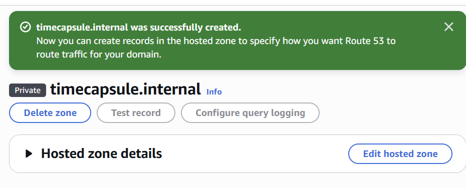

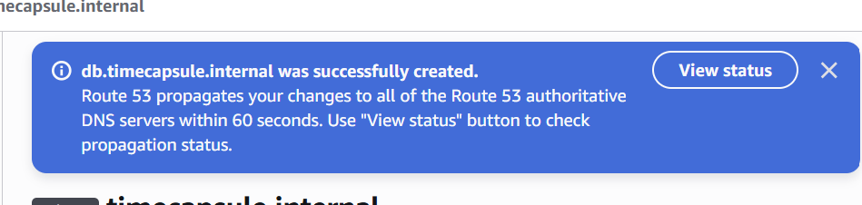


C App server:

[ec2-user@ip-10-7-0-195 ~]$ dig +short db.timecapsule.internal
10.7.10.151
С моего компьютера : 
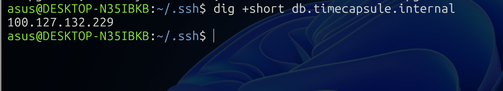

100.127.132.229

С App Server: db.timecapsule.internal → 10.7.10.151 — DNS успешно разрешает имя во внутренний IP-адрес DB Server.

С компьютера: 100.127.132.229 — это адрес из диапазона 100.64.0.0/10 (Shared Address Space, RFC 6598), который не является публично маршрутизируемым адресом.    

     Что придётся изменить, если db-server пересоздадут с другим IP-адресом?

Необходимо обновить A-запись в Route 53 Private Hosted Zone, заменив старый IP-адрес 10.7.10.151 на новый.

При этом конфигурацию app-server менять не потребуется, если приложение подключается к базе данных по DNS-имени db.timecapsule.internal, а не по IP-адресу.

использование DNS упрощает управление инфраструктурой, поскольку позволяет изменять IP-адреса серверов без изменения настроек приложений.

## Задание 12. Перенос данных и переключение приложения

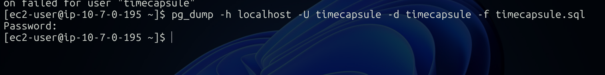


```json
{"status":"ok","db":"ok","hostname":"ip-10-7-0-195.eu-central-1.compute.internal"}
```


Прикреплённые пользователями файлы хранятся локально на app-server в каталоге storage/uploads, который указан в переменной окружения:
UPLOAD_DIR=storage/uploads


Они находятся в файловой системе EC2-инстанса, а не в PostgreSQL. Поэтому файлы попали в AMI-образ вместе с приложением.
Если удалить app-server:
- Если корневой EBS-том настроен на Delete on termination, он будет удалён вместе с инстансом, и загруженные файлы будут потеряны.
- Файлы, сохранённые в AMI на момент создания образа, останутся в его EBS-снимках.
- Новые файлы, загруженные после создания AMI, в старом образе отсутствуют.

## Задание 13. Деплой и обслуживание


## Задание 14. Архитектура и решение


# Контрольные вопросы

### 1. Как проходит запрос от браузера до базы данных?

1. Браузер отправляет `HTTP/HTTPS-запрос` через интернет.
2. Internet Gateway пропускает запрос в публичную подсеть VPC.
3. Route Table направляет трафик к `web-server`.
4. `Security Group (web-sg)` проверяет разрешённые порты `(80/443)`.
5. `Web-server` обрабатывает запрос и обращается к db-server.
6. Security Group (db-sg) разрешает подключение только от web-server на порт базы данных.
7. База данных возвращает результат через web-server пользователю.


### 2. Что нужно злоумышленнику для подключения к базе?

Одного приватного IP недостаточно. Ему необходимы:
- Доступ внутрь VPC, например через скомпрометированный сервер или VPN.
- Разрешение Security Group на подключение к БД.
- Логин и пароль базы данных.


### 3. Чем временный NAT Gateway лучше постоянного?

**Преимущество**: экономия денег, поскольку NAT Gateway оплачивается за время работы и обработанный трафик.

**Недостатки**: его нужно создавать и удалять, изменять маршруты. Когда NAT Gateway удалён, приватные серверы теряют доступ к интернету через него.


### 4. Как обеспечить работу при отказе `eu-central-1a`?

Необходимо разместить резервные ресурсы в другой зоне, например eu-central-1b.
Для этого нужны:
- Дополнительные публичная и приватная подсети.
- Резервный `web-server` и реплика базы данных.
- Application Load Balancer для распределения запросов.
- Автоматическое переключение на работающие серверы.
- NAT Gateway во второй зоне, если приватным серверам нужен независимый выход в интернет.

Итог: при отказе `eu-central-1a` приложение продолжит работать через eu-central-1b.


