# Лабораторная работа №4. Облачные хранилища. Amazon S3

## Цель работы

Научиться хранить файлы в объектном хранилище Amazon S3 и управлять ими: создавать бакет и объекты в консоли и из командной строки, защищать данные версионированием, ограничивать рост хранилища правилами жизненного цикла и управлять доступом с помощью политик.  
Затем перенести загруженные файлы приложения из лабораторной работы №3 с диска сервера в S3, чтобы сервер приложения перестал хранить данные пользователей.

# Часть 1. Базовый уровень

## Задание 1. Бакет и объекты в консоли

Бакет Amazon S3 предназначен для хранения файлов различных типов: изображений, документов и резервных копий.

В бакете находятся 3 объекта, организованные по двум логическим папкам (префиксам): `uploads/` и `backups/`

1. Какой ключ у картинки?

Ключ картинки — uploads/girl-dotted.png. Это уникальное имя объекта внутри бакета S3, включающее префикс uploads/ и название файла.

2. Почему `Object URL` не открывается, хотя вы владелец бакета?

Потому что в бакете включена настройка Block all public access, которая запрещает публичный доступ к объектам. Владение бакетом не означает, что браузер автоматически получает права доступа. При открытии URL без авторизации возникает ошибка 403 Access Denied.

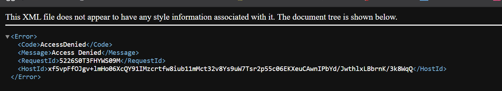

3. Что на самом деле создала кнопка `Create folder`?

В Amazon S3 нет настоящих папок, как в обычной файловой системе. Кнопка Create folder создаёт объект нулевого размера с ключом uploads/. Остальные объекты с таким префиксом отображаются внутри этой виртуальной папки.

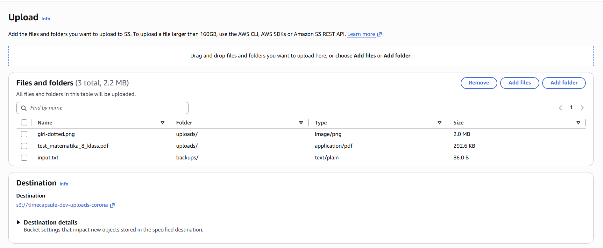


## Задание 2. Объекты из командной строки

> Переменная живёт до закрытия CloudShell


```bash
BUCKET=timecapsule-dev-uploads-corona
```

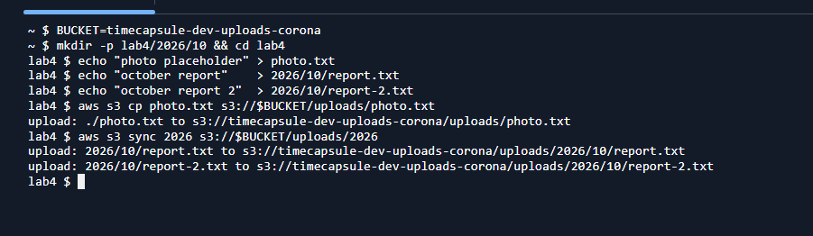

создал текстовые файлы с строковым содержанием и скопировал их в бакет


```bash
# 1
lab4 $ aws s3 ls s3://$BUCKET

                           PRE uploads/

# 2 
lab4 $ aws s3 ls s3://$BUCKET/uploads/

                           PRE 2026/
2026-10-28 22:30:54         18 photo.txt


# 3
lab4 $ aws s3 ls s3://$BUCKET --recursive

2026-10-28 22:31:02         17 uploads/2026/10/report-2.txt
2026-10-28 22:31:02         15 uploads/2026/10/report.txt
2026-10-28 22:30:54         18 uploads/photo.txt
lab4 $ 
```

> **Ключ** (Key) в `Amazon S3` — это уникальное имя объекта (файла) внутри бакета.

```bash
lab4 $ aws s3api head-object --bucket $BUCKET --key uploads/girl-dotted.png
{
    "AcceptRanges": "bytes",
    "LastModified": "2026-10-28T22:42:23+00:00",
    "ContentLength": 2051609,
    "ETag": "\"248441896538926463dbd654bbd41baa\"",
    "ContentType": "image/png",
    "ServerSideEncryption": "AES256",
    "Metadata": {}
}
```

> `Скачать файл` - в контексте означает скопировать его под другим именем в другое место

```bash
lab4 $ aws s3 cp s3://$BUCKET/uploads/photo.txt downloaded.txt && cat downloaded.txt
download: s3://timecapsule-dev-uploads-corona/uploads/photo.txt to ./downloaded.txt
photo placeholder
```


```bash
lab4 $ aws s3 rm s3://$BUCKET/uploads/2026/10/report-2.txt
delete: s3://timecapsule-dev-uploads-corona/uploads/2026/10/report-2.txt
```

### 1. Почему первая команда показывает PRE uploads/ и PRE backups/, а третья — полные ключи?

Команда `aws s3 ls s3://$BUCKET` показывает содержимое корня бакета. `PRE` означает Prefix (префикс) — виртуальную папку в S3.

Команда `aws s3 ls s3://$BUCKET/uploads/` показывает объекты только внутри префикса `uploads/`.

Команда `aws s3 ls s3://$BUCKET --recursive`
рекурсивно выводит все объекты бакета с их полными ключами, например `uploads/2026/10/report.txt`.

Причина: Amazon S3 использует плоскую структуру хранения. Папки — это логические группировки объектов по префиксам их ключей.

### 2. Какой Content-Type получил report.txt, хотя вы его не указывали?

При загрузке через aws s3 sync AWS CLI автоматически определяет `MIME`-тип файла по его расширению.

Для report.txt обычно устанавливается:

`Content-Type: text/plain`

## Задание 3. Политика бакета: только HTTPS

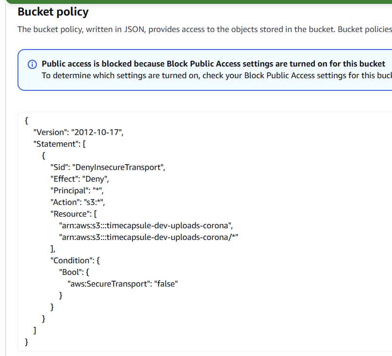

```bash
lab4 $ aws s3 ls s3://$BUCKET/uploads/
                           PRE 2026/
2026-10-28 22:42:23    2051609 girl-dotted.png
2026-10-28 22:42:25    3332202 myPDF.pdf
2026-10-28 22:30:54         18 photo.txt
lab4 $ aws s3 ls s3://$BUCKET/uploads/ --endpoint-url http://s3.eu-central-1.amazonaws.com

aws: [ERROR]: An error occurred (AccessDenied) when calling the ListObjectsV2 operation: User: arn:aws:iam::563807597435:user/corona is not authorized to perform: s3:ListBucket on resource: "arn:aws:s3:::timecapsule-dev-uploads-corona" with an explicit deny in a resource-based policy

```

### 1. Почему вторая команда получает AccessDenied, хотя у вас права администратора?

Потому что в Bucket Policy установлен явный запрет (Effect: Deny) на любые запросы через HTTP (aws:SecureTransport: false).

В AWS явный Deny имеет приоритет над любыми разрешениями (Allow), даже если пользователь обладает правами администратора.
### 2. Почему Block Public Access не помешал сохранить политику с "Principal": "*"?

Потому что "Principal": "*" не обязательно означает публичный доступ.

В нашей политике используется Effect: Deny, то есть она запрещает действия всем пользователям при определённом условии, а не предоставляет им доступ.

Block Public Access предотвращает предоставление публичного доступа, но не запрещает политики, которые ограничивают доступ.


## Задание 4. Версионирование и защита от удаления

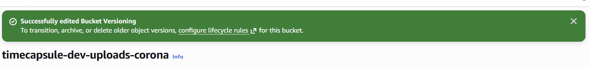

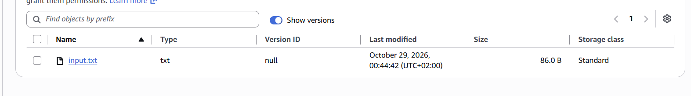

**NULL VERSION ID**

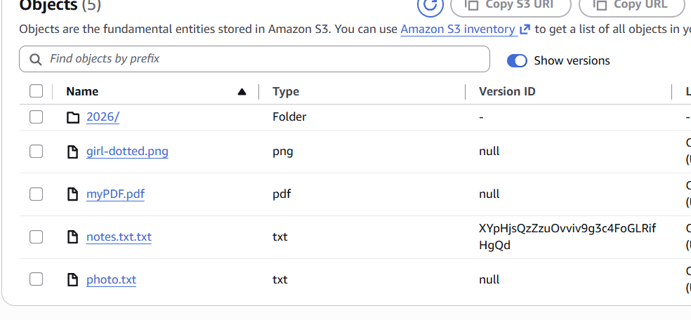

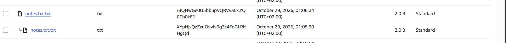

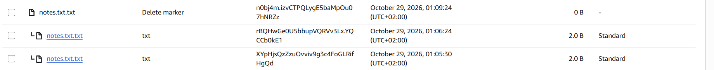

Удаление и откат

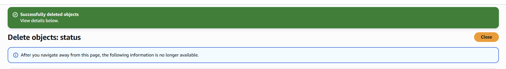

**1. Чем отличается удаление в шаге 3 от шага 5?**

- Шаг 3 — логическое удаление. S3 создаёт Delete marker, который скрывает объект, но сохраняет все его версии.
- Шаг 5 — физическое удаление конкретной версии. S3 окончательно удаляет выбранную версию объекта по её Version ID.

**2. Какое удаление можно отменить?**

- Шаг 3: можно отменить, удалив Delete marker. Объект снова станет доступен.
- Шаг 5: нельзя отменить средствами S3 Versioning, поскольку выбранная версия удаляется безвозвратно.

**3. Какой способ защищает от случайного удаления, а какой нужно запрещать приложению?**

Логическое удаление (шаг 3) защищает от случайной потери данных, поскольку сохраняет предыдущие версии.

Физическое удаление версий (шаг 5) следует запрещать обычному приложению, чтобы оно не могло безвозвратно уничтожить данные.

Для этого в IAM можно разрешить `s3:DeleteObject`, но не предоставлять `s3:DeleteObjectVersion`.

## Задание 5. Правило жизненного цикла

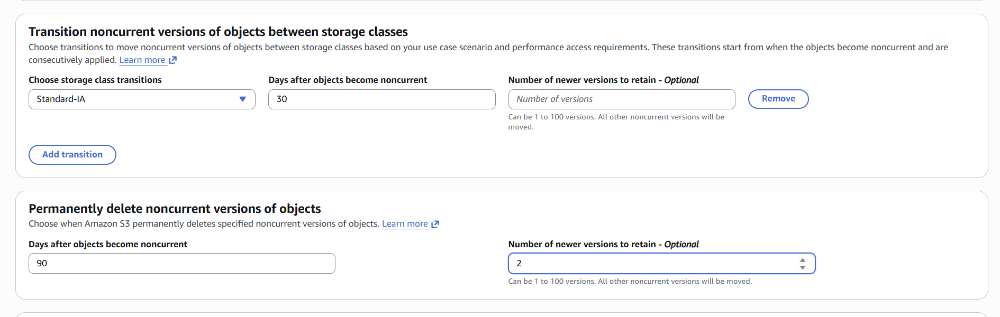

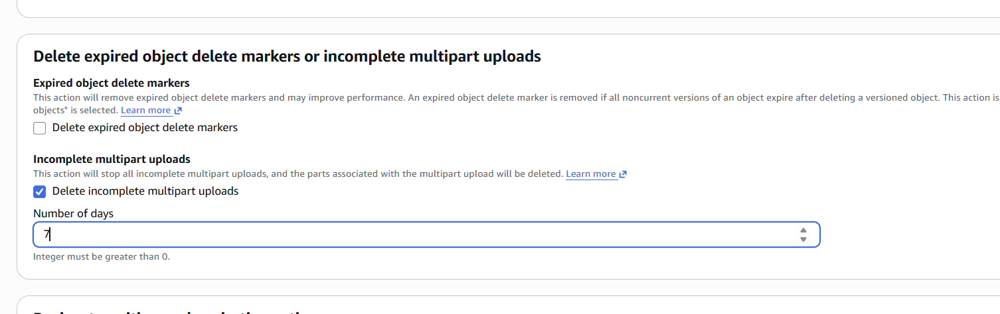

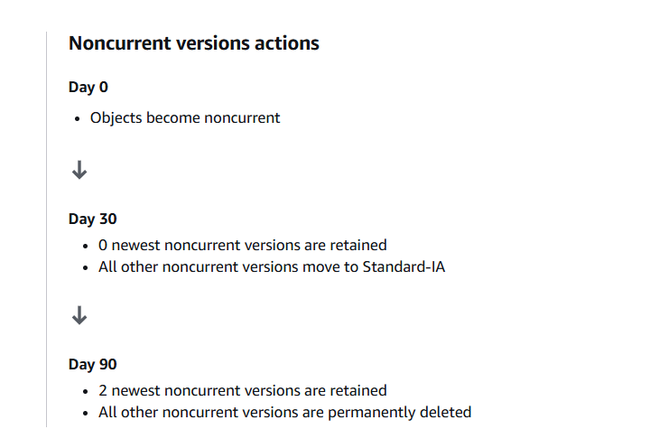

**1. Что произойдёт с файлом, перезаписанным 10 раз за неделю?**

При каждой перезаписи S3 создаёт новую версию, сохраняя предыдущие. После 10 загрузок будет 10 версий: 1 текущая и 9 неактуальных.

- Через 30 дней после того, как каждая версия стала неактуальной, она перейдёт в Standard-IA, если соответствует требованиям перехода.

- Через 90 дней неактуальные версии начнут удаляться, но только если у них есть минимум две более новые неактуальные версии.

- Две последние неактуальные версии сохранятся, как и текущая версия.
Таким образом, после выполнения всех сроков останутся 3 версии: текущая и две предыдущие.

Сроки отсчитываются отдельно для каждой версии, а не от первой загрузки файла.

**2. Почему маленькие тестовые файлы не попадут в Standard-IA?**

Потому что по умолчанию S3 Lifecycle не переводит объекты размером менее 128 КБ в другие классы хранения.

тестовые файлы `notes.txt` и `report.tx`t содержат всего несколько байтов, поэтому переход не произойдёт.

Кроме того, `Standard-IA` предусматривает минимальный оплачиваемый размер объекта 128 КБ, поэтому хранение маленьких файлов в этом классе обычно экономически невыгодно.

**3. Что такое незавершённая загрузка частями `(Multipart Upload)`?**

`Multipart Upload` — способ загрузки больших файлов в S3 отдельными частями, которые затем объединяются в один объект.

Если загрузка прервалась или не была завершена командой `CompleteMultipartUpload`, уже загруженные части остаются в S3.

**4. Почему за них приходится платить?**

Потому что эти части занимают место в хранилище, даже если полноценный объект ещё не создан.

`Lifecycle Rule` автоматически удаляет такие незавершённые загрузки через 7 дней, предотвращая лишние расходы.

## Задание 6. Подписанные URL

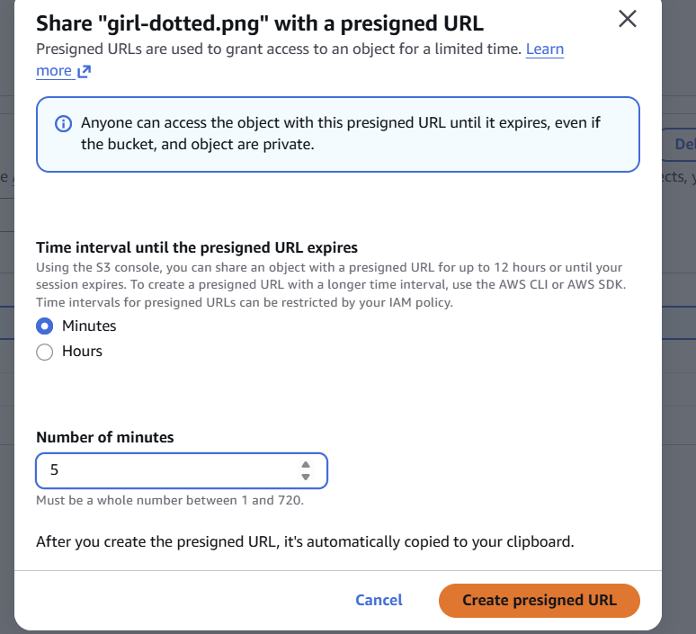

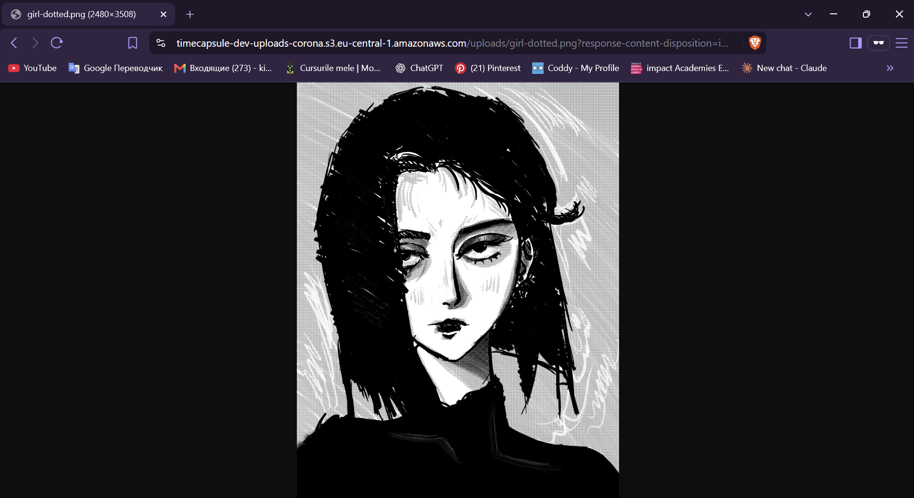

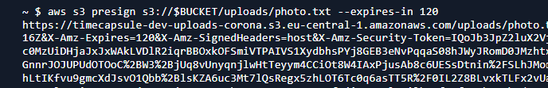

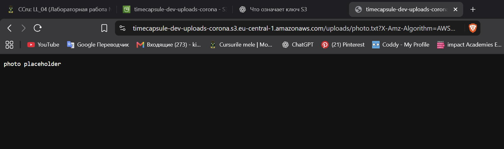

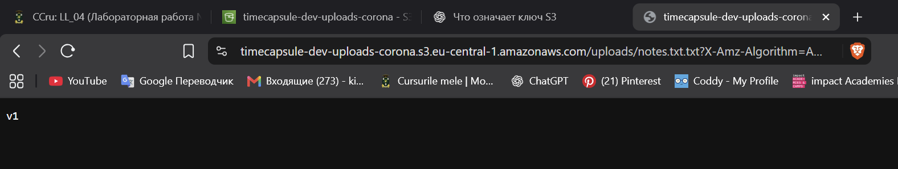

**1. Какие ошибки вернул S3 в шагах 3 и 4?**

Шаг 3 — `SignatureDoesNotMatch` (HTTP 403).

При замене photo.txt на notes.txt изменяется ключ объекта, но цифровая подпись остаётся прежней. S3 обнаруживает несоответствие и отклоняет запрос.

Шаг 4 — `AccessDenied` (HTTP 403).

После истечения 120 секунд подписанная ссылка становится недействительной. Обычно S3 возвращает AccessDenied с сообщением Request has expired.

**2. Почему нельзя получить другой файл, просто поменяв ключ в ссылке?**

Потому что Presigned URL содержит криптографическую подпись, которая привязана к конкретному объекту, HTTP-методу и параметрам запроса.

Если изменить ключ файла, подпись перестанет соответствовать запросу. Для доступа к другому объекту необходимо создать новую подписанную ссылку.

**3. Обращалась ли команда aws s3 presign к S3 при создании ссылки?**

Нет. Команда `aws s3 presign` формирует подписанную ссылку локально, используя AWS credentials, регион, ключ объекта и срок действия.

Она не отправляет запрос к S3 для создания ссылки и не проверяет существование объекта. Обращение к S3 происходит только при открытии сформированного URL.

Примечание: Если CloudShell использует временные AWS credentials, ссылка может перестать работать раньше указанного срока при истечении этих credentials.

**Спустя 2 минуты:** Отказ в доступе

```
~ $ cd ~ && rm -rf lab4
```

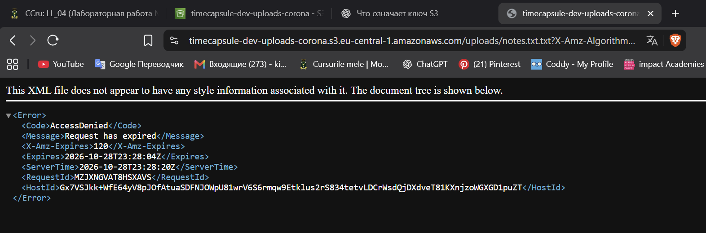


# Часть 2. Продвинутый уровень

## Задание 7. Политика приложения

`ARN` (Amazon Resource Name) — это уникальный идентификатор ресурса в AWS.

ARN используется, чтобы указать AWS, к какому именно ресурсу применяется действие или разрешение.

`arn:aws:s3:::my-bucket/uploads/photo.txt`

**AWS Console → IAM → Policies → Create policy → JSON**

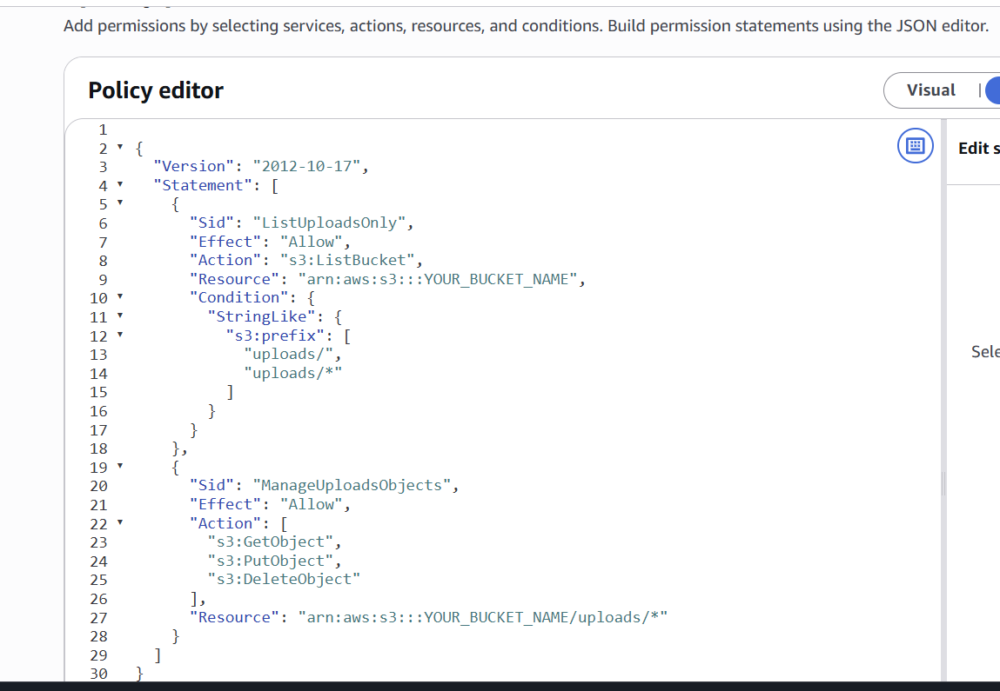

**1. Почему s3:ListBucket относится к бакету, а s3:GetObject — к объекту?**

Потому что эти действия работают с разными уровнями S3.

    Действие	Ресурс	ARN
    s3:ListBucket	Бакет	arn:aws:s3:::my-bucket
    s3:GetObject	Объект	arn:aws:s3:::my-bucket/uploads/*

`s3:ListBucket` получает список ключей объектов в бакете. Даже когда используется префикс `uploads/`, операция выполняется на уровне бакета.

`s3:GetObject` получает содержимое конкретного объекта, поэтому требует ARN объекта.

**2. Что произойдёт, если перепутать ARN?**

Если для `s3:ListBucket` указать ARN объекта, а для `s3:GetObject` — ARN бакета, эти разрешения не будут соответствовать требуемым ресурсам.

В результате операции будут отклоняться с ошибкой AccessDenied (403), если другие политики не предоставляют нужных разрешений.

**3. Проверка политики через AWS CLI**

После прикрепления политики к IAM-пользователю или роли приложения можно проверить её работу с соответствующими учётными данными.

    Команда	Ожидаемый результат

    aws s3 ls s3://$BUCKET/uploads/	Разрешено
    aws s3 ls s3://$BUCKET	AccessDenied
    aws s3 cp test.txt s3://$BUCKET/uploads/	Разрешено
    aws s3 cp test.txt s3://$BUCKET/backups/	AccessDenied

> Результаты предполагают, что нет дополнительных разрешающих политик или явных запретов, влияющих на запросы.

Эта IAM-политика разрешает приложению работать только с объектами внутри uploads/ в бакете timecapsule-dev-uploads-corona.

1. `ListUploadsOnly` — разрешает просматривать список файлов только в uploads/.
2. `ManageUploadsObjects` — разрешает:

   - ``GetObject`` — скачивать и читать файлы.

   - `PutObject` — загружать файлы.

   - `DeleteObject` — удалять файлы.

3. `Resource` (ARN) — определяет, к какому бакету или объектам применяются разрешения.

4. `Condition` — ограничивает просмотр списка файлов префиксом uploads/.

5. `Effect: Allow` — явно разрешает перечисленные действия.

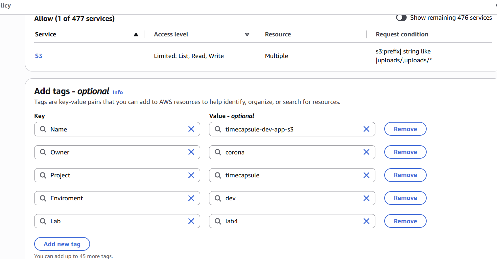

## Задание 8. Проверка прав через тестовую роль

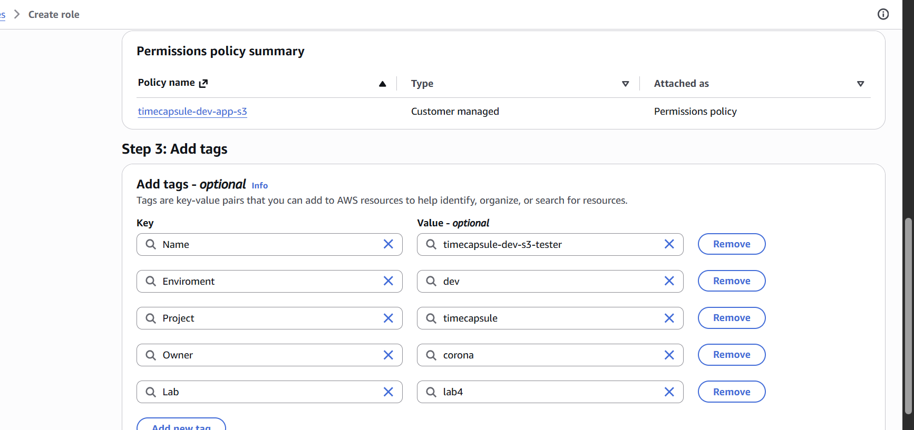

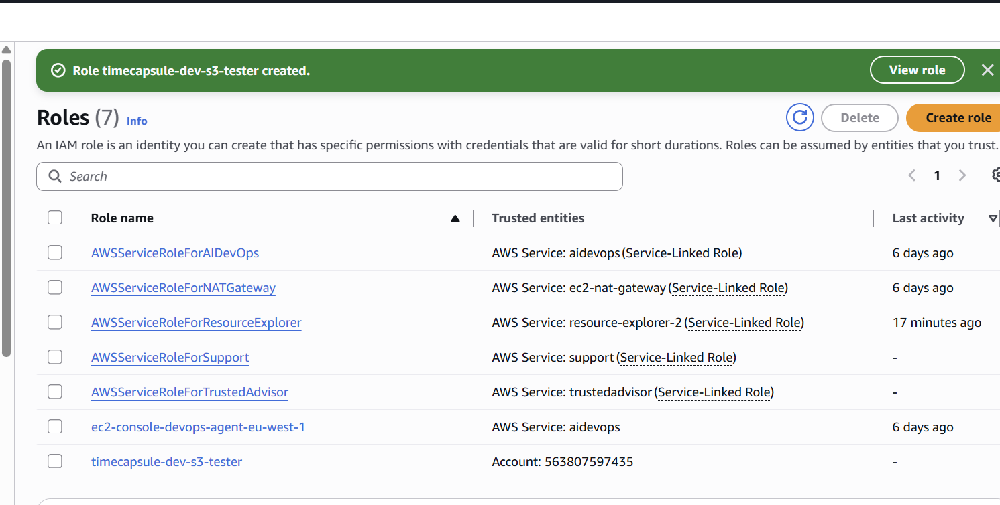

```js
~ $ BUCKET=timecapsule-dev-uploads-corona
~ $ ROLE_ARN=arn:aws:iam::$(aws sts get-caller-identity --query Account --output text):role/timecapsule-dev-s3-tester
~ $ eval $(aws sts assume-role --role-arn $ROLE_ARN --role-session-name lab4 \
>  --query 'Credentials.[AccessKeyId,SecretAccessKey,SessionToken]' --output text \
>  | awk '{print "export AWS_ACCESS_KEY_ID="$1" AWS_SECRET_ACCESS_KEY="$2" AWS_SESSION_TOKEN="$3}')
~ $ aws sts get-caller-identity
{
"UserId": "AROAYGRMNGN5SPG7BNIXL:lab4",
"Account": "563807597435",
"Arn": "arn:aws:sts::563807597435:assumed-role/timecapsule-dev-s3-tester/lab4"
}
```

| № | Команда | Ожидаю | Получил | Какое правило сработало |
|---|---|---|---|---|
| 1 | `aws s3 cp test.txt s3://$BUCKET/uploads/test.txt` | Успех | Успех | Allow `s3:PutObject` для `uploads/*` |
| 2 | `aws s3 ls s3://$BUCKET/uploads/` | Успех | Успех | Allow `s3:ListBucket` с `s3:prefix=uploads/` |
| 3 | `aws s3 ls s3://$BUCKET` | AccessDenied | AccessDenied | Неявный Deny: пустой префикс |
| 4 | `aws s3 cp s3://$BUCKET/uploads/photo.txt -` | Успех | Успех | Allow `s3:GetObject` для `uploads/*` |
| 5 | `aws s3 ls s3://$BUCKET/backups/` | AccessDenied | AccessDenied | Неявный Deny: префикс `backups/` не разрешён |
| 6 | `aws s3 cp test.txt s3://$BUCKET/backups/test.txt` | AccessDenied | AccessDenied | Неявный Deny: `s3:PutObject` вне `uploads/*` |
| 7 | `aws s3api list-object-versions --bucket $BUCKET --prefix uploads/` | AccessDenied | AccessDenied | Неявный Deny: нет `s3:ListBucketVersions` |
| 8 | `aws s3api delete-object --bucket $BUCKET --key uploads/test.txt --version-id <VersionId>` | AccessDenied | AccessDenied | Неявный Deny: нет `s3:DeleteObjectVersion` |
| 9 | `aws s3 rm s3://$BUCKET/uploads/test.txt` | Успех | Успех | Allow `s3:DeleteObject` для `uploads/*` |
| 10 | `aws s3 ls s3://$BUCKET/uploads/ --endpoint-url http://s3.eu-central-1.amazonaws.com` | Ошибка перенаправления или подключения | Зависит от ответа S3 | IAM разрешает `s3:ListBucket`, но endpoint может быть некорректным |

**1. Чем политика доверия отличается от политики прав?**

- Trust Policy (политика доверия) — определяет, кто может принять роль IAM (sts:AssumeRole).

- Permissions Policy (политика прав) — определяет, какие действия разрешены этой роли и над какими ресурсами.

Например, EC2 может получить роль через Trust Policy, а Permissions Policy разрешает ей работать с S3.

**2. Что произошло с test.txt после команды 9?**

Команда:

`aws s3 rm s3://$BUCKET/uploads/test.txt`


Если в бакете включено `Versioning` (версионирование), файл не удаляется физически. S3 создаёт Delete Marker — специальную метку удаления, которая скрывает объект при обычных запросах.

Предыдущие версии сохраняются. Файл можно восстановить, удалив `Delete` Marker с соответствующими правами.

Если версионирование не включено, обычное удаление может быть необратимым.

**3. Может ли злоумышленник безвозвратно удалить файлы?**

При включённом `Versioning` и с текущей IAM-политикой — не может напрямую удалить сохранённые версии файлов, поскольку у приложения отсутствует разрешение `s3:DeleteObjectVersion`.


Однако злоумышленник сможет удалять текущие объекты (создавая Delete Markers) и перезаписывать файлы в uploads/, нарушая работу приложения.

**4. Что изменилось бы при "s3:*"?**

`"s3:*"` разрешает все действия S3 над указанными ресурсами, если другие политики их не запрещают.

Если разрешения распространяются на бакет и все его объекты, злоумышленник потенциально сможет:

- Удалять конкретные версии файлов (s3:DeleteObjectVersion).
- Изменять настройки бакета, включая версионирование.
- Изменять политики доступа.
- Удалять файлы без возможности восстановления из S3, если нет дополнительных защит, например Object Lock

## Задание 9. Роль сервера

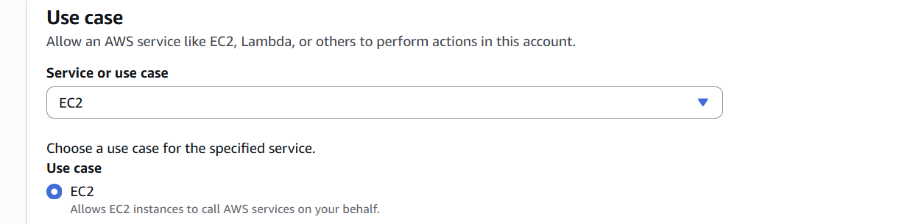

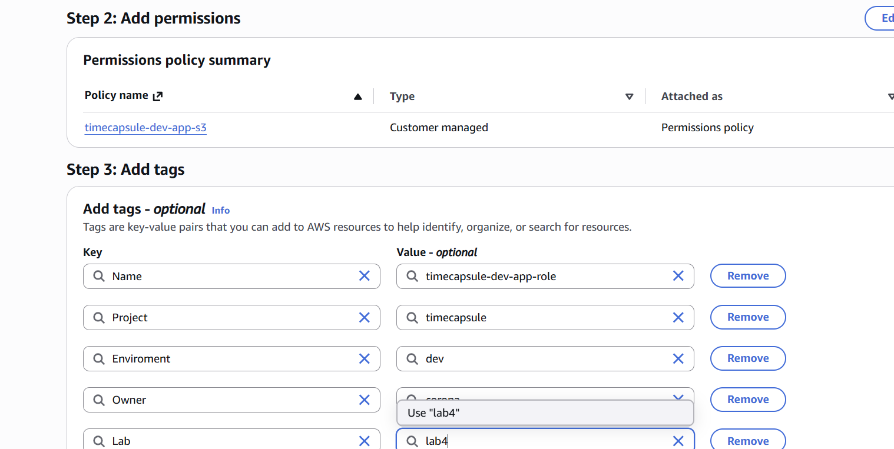

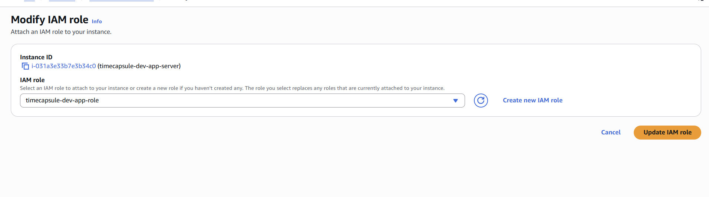

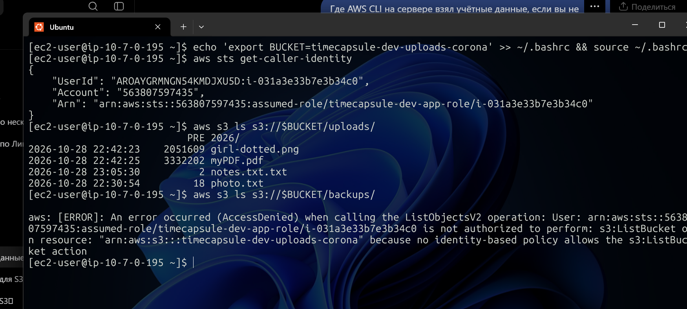

### 1. Где AWS CLI взял учётные данные?

AWS CLI автоматически получил временные учётные данные IAM-роли, привязанной к EC2-инстансу через Instance Profile.

Когда мы выполняем команду AWS CLI, происходит следующее:

1. AWS CLI обращается к Instance Metadata Service (IMDS) по адресу `169.254.169.254`.
2. EC2 предоставляет временные учётные данные назначенной IAM-роли.
3. AWS CLI автоматически использует их для выполнения запросов к AWS.
4. AWS обновляет эти данные до истечения срока их действия.

Поэтому выполнять `aws configure` или `assume-role` вручную не требуется.

Проверить текущую роль можно командой:

```
aws sts get-caller-identity
```

### 2. Чем политика доверия этой роли отличается от тестовой?

Политика доверия (Trust Policy) определяет, кто может принять роль.

В тестовой роли доверие могло быть настроено на конкретного IAM-пользователя или другую IAM-роль.

В роли EC2 доверие предоставляется сервису `ec2.amazonaws.com`:

```bash
{
  "Version": "2012-10-17",
  "Statement": [
    {
      "Effect": "Allow",
      "Principal": {
        "Service": "ec2.amazonaws.com"
      },
      "Action": "sts:AssumeRole"
    }
  ]
}
```

Таким образом, EC2 может использовать эту роль для получения временных учётных данных.

При этом политика прав (Permissions Policy) отдельно определяет, какие операции разрешены, например `s3:GetObject` или `s3:PutObject`.

### 3. Почему это безопаснее ключа доступа в `.env`?

| IAM-роль EC2                    | Ключ доступа в `.env`                                  |
| ------------------------------- | ------------------------------------------------------ |
| Временные учётные данные        | Обычно долгосрочные ключи                              |
| Автоматически обновляются       | Требуют ручной ротации                                 |
| Не нужно хранить ключи в файлах | Ключи могут попасть в Git                              |
| Доступ управляется IAM          | Украденный ключ работает до отзыва или истечения срока |
| Можно отозвать доступ через IAM | Нужно отдельно отключать ключ                          |

Важно: если злоумышленник получит доступ к EC2 и сможет извлечь временные учётные данные, он тоже сможет использовать разрешённые ролью действия до истечения срока их действия. Поэтому права роли необходимо ограничивать.


## Задание 10. Перенос существующих файлов

Скопировал файлы в бакет. На app-server сначала запустил синхронизацию в режиме проверки, затем по-настоящему.

    cd /var/www/timecapsule/current
    aws s3 sync storage/uploads s3://$BUCKET/uploads/ --dryrun
    aws s3 sync storage/uploads s3://$BUCKET/uploads/

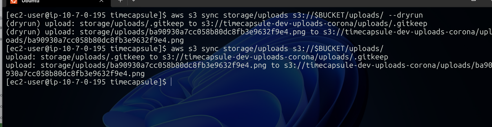

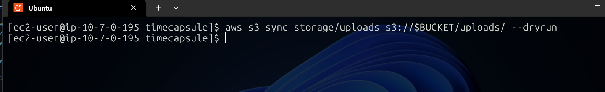

    aws s3api head-object \
    --bucket "$BUCKET" \
    --key uploads/girl-dotted.png \
    --query ContentType

    "image/png"
    

Да, прав политики приложения хватило для выполнения `aws s3 sync`, поскольку файлы были успешно синхронизированы с S3.

Команда использовала следующие разрешения IAM:

- `s3:ListBucket` — получение списка объектов в бакете с префиксом `uploads/`, чтобы определить, какие файлы уже существуют.
- `s3:PutObject` — загрузка новых или изменённых файлов в S3.
- `s3:GetObject` — разрешение на чтение объектов; при обычной синхронизации с локального сервера в S3 оно не требуется, но использовалось при проверке `Content-Type` через `head-object`.

`s3:DeleteObject` не использовалось, поскольку синхронизация выполнялась без параметра `--delete`.

## Задание 11. Модуль хранения на S3

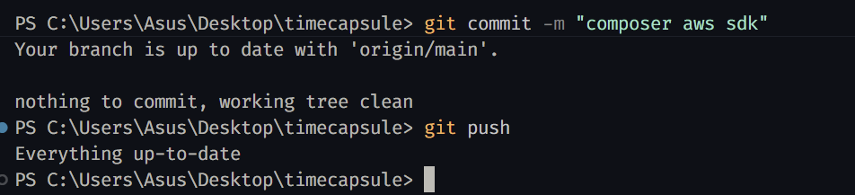

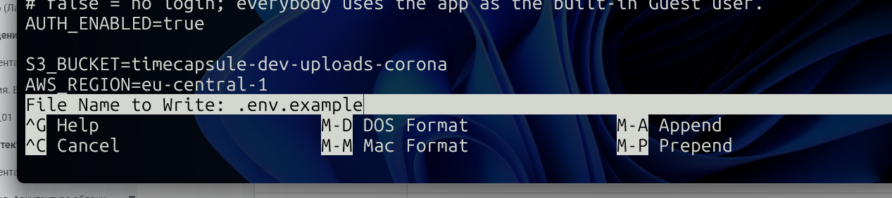

```php
use Aws\S3\S3Client;

$s3 = new S3Client([
    'region' => config('AWS_REGION')
]);

$bucket = config('AWS_BUCKET');
```

```php
function storage_save(array $uploadedFile, string $extension): string
{
    global $s3, $bucket;

    $storedName = bin2hex(random_bytes(16)) . '.' . $extension;

    $s3->putObject([
        "Bucket" => $bucket,
        "Key" => 'uploads/' . $storedName,
        'SourceFile' => $uploadedFile['tmp_name'],
        'ContentType' => mime_content_type($uploadedFile["tmp_name"]),
    ]);

    return $storedName;
}
```

```php
// Redirect browser to a presigned S3 URL
function storage_stream(
    string $storedName,
    string $mime,
    string $downloadName,
    string $disposition
): void {
    global $s3, $bucket;

    $command = $s3->getCommand('GetObject', [
        'Bucket' => $bucket,
        'Key' => 'uploads/' . basename($storedName),
        'ResponseContentType' => $mime,
        'ResponseContentDisposition' => sprintf(
            '%s; filename="%s"; filename*=UTF-8\'\'%s',
            $disposition,
            preg_replace('/[^A-Za-z0-9._ -]/', '_', $downloadName),
            rawurlencode($downloadName)
        ),
    ]);

    $request = $s3->createPresignedRequest(
        $command,
        '+5 minutes'
    );

    header('Location: ' . (string) $request->getUri(), true, 302);
    exit();
}
```


```html
<footer class="site-footer">
    <h1>Я сделал 4 лабораторную работу по AWS пункт 13</h1>
    <div class="container">
        <?php /* Shows which machine answered, which database host it uses and where files are stored. */ ?>
        Served by <code><?= e(gethostname()) ?></code>
        · DB: <code><?= e(config('DB_HOST', 'localhost')) ?></code>
        · Files: <code>S3 (<?= e(config('AWS_BUCKET')) ?>)</code>
    </div>
</footer>
```

## Задание 12. Деплой и проверка

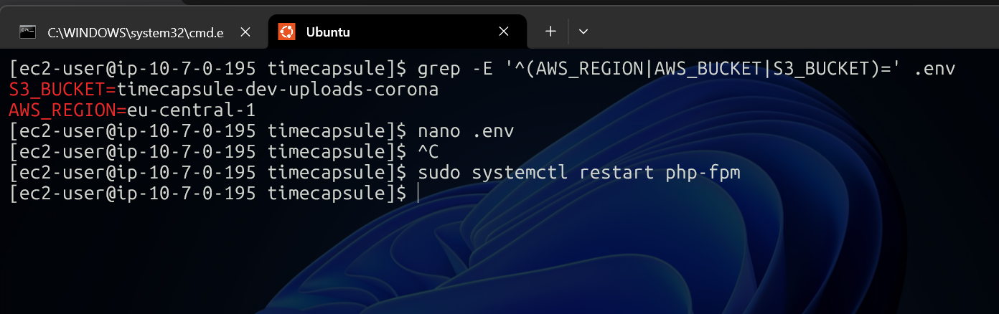

Задеплоил и устранил ошибку **500** на сервере - неправильный **dotenv**

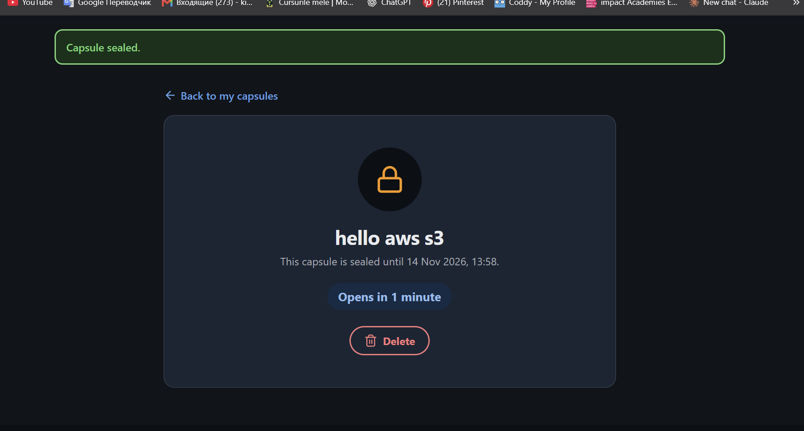

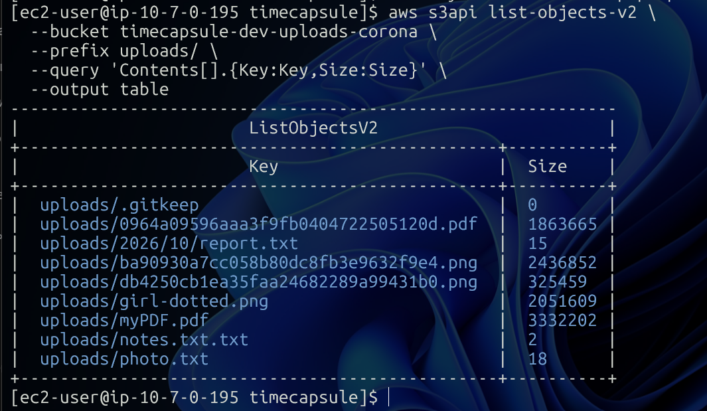

```bash
[ec2-user@ip-10-7-0-195 timecapsule]$ aws s3api head-object \
  --bucket timecapsule-dev-uploads-corona \
  --key "uploads/0964a09596aaa3f9fb0404722505120d.pdf"
{
    "AcceptRanges": "bytes",
    "LastModified": "2026-11-14T11:58:40+00:00",
    "ContentLength": 1863665,
    "ETag": "\"e86266d68ddbfb1fe552c0b07a77ab66\"",
    "VersionId": "Ge4BgFDh4vfcdSdE5ArhBNp9oDGJYaaA",
    "ContentType": "application/pdf",
    "ServerSideEncryption": "AES256",
    "Metadata": {}
}
[ec2-user@ip-10-7-0-195 timecapsule]$
```

```bash
{
    "AcceptRanges": "bytes",
    "LastModified": "2026-11-14T11:57:09+00:00",
    "ContentLength": 325459,
    "ETag": "\"e5c59fb4e2880841f676b73fc7a2f3ec\"",
    "VersionId": "adiTvPs1OMkcnkGNhYaZ8DCtICisS.8r",
    "ContentType": "image/png",
    "ServerSideEncryption": "AES256",
    "Metadata": {}
}
```

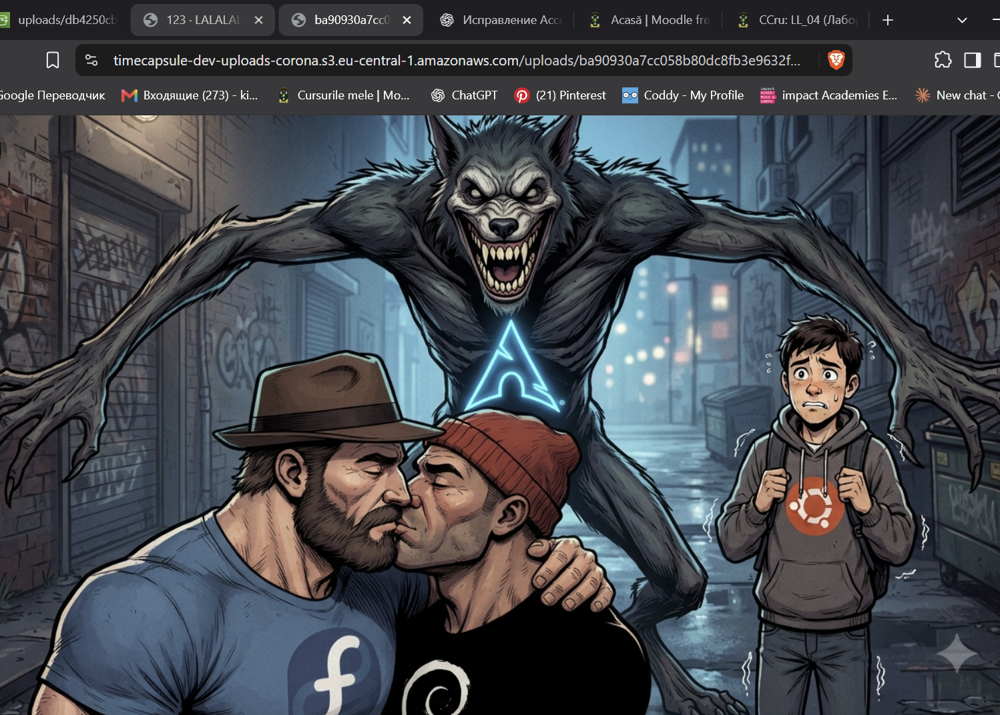

### **1. Почему ссылку не нужно специально отзывать?**

Используется **Presigned URL** — временная подписанная ссылка с ограниченным сроком действия. После истечения срока ссылка автоматически перестаёт работать, даже если пользователь переслал её другу. Отдельно отзывать её не требуется.

### **2. Что остаётся в S3 после удаления капсулы?**

После удаления капсулы сам объект в S3 может остаться, если приложение удаляет только запись из базы данных, но не физический файл из Bucket.

Файл продолжает занимать место в хранилище, пока его не удалит приложение или администратор.

### **3. Когда файл исчезнет окончательно?**

Файл исчезнет после физического удаления из S3. Если настроено правило **S3 Lifecycle**, объект может удалиться автоматически по истечении установленного срока. Без такого правила он будет храниться бессрочно.


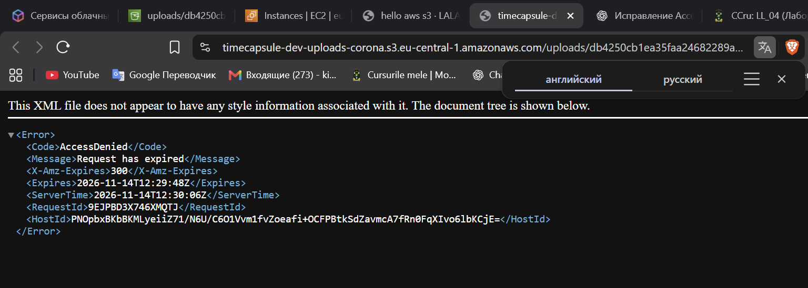


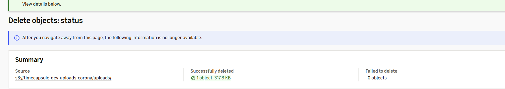

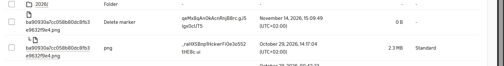

## Задание 13. Сервер без состояния

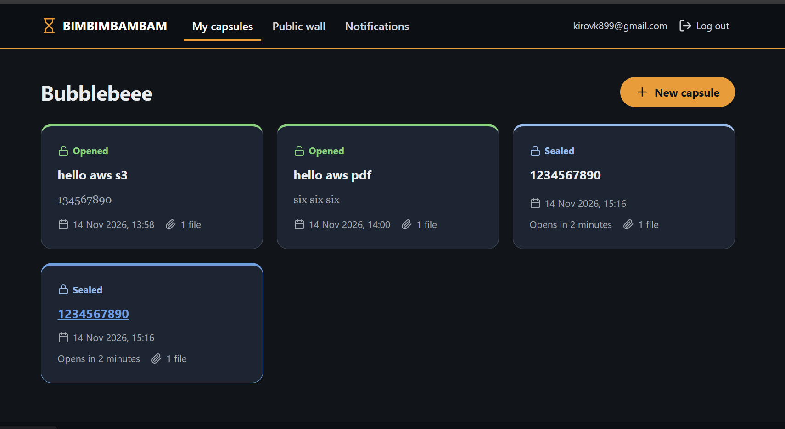

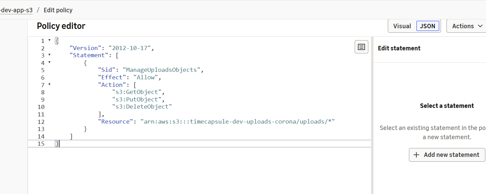

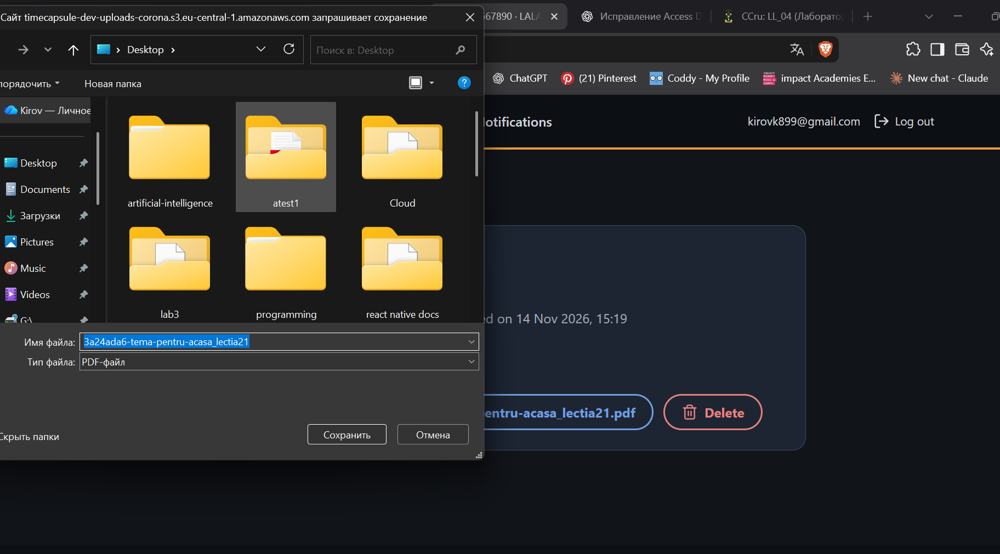


```bash
aws s3 ls s3://$BUCKET/uploads/

aws: [ERROR]: An error occurred (AccessDenied) when calling the ListObjectsV2 operation: User: arn:aws:sts::563807597435:assumed-role/timecapsule-dev-app-role/i-031a3e33b7e3b34c0 is not authorized to perform: s3:ListBucket on resource: "arn:aws:s3:::timecapsule-dev-uploads-corona" because no identity-based policy allows the s3:ListBucket action
[ec2-user@ip-10-7-0-195 www]$
```


На сервере:


```bash
[ec2-user@ip-10-7-0-195 www]$ aws s3 cp s3://$BUCKET/uploads/no-such-file.txt /tmp/no-such-file.txt
fatal error: An error occurred (403) when calling the HeadObject operation: Forbidden
[ec2-user@ip-10-7-0-195 www]$
```

в CLOUDShell:

```bash
~ $ aws s3 cp s3://$BUCKET/uploads/no-such-file.txt /tmp/no-such-file.txt
fatal error: An error occurred (404) when calling the HeadObject operation: Key "uploads/no-such-file.txt" does not exist

```

Разница именно в `IAM-правах`. Это ожидаемый результат эксперимента.

Сравнение результатов

Среда	Результат	Значение

**EC2 (app-server)**	`403 Forbidden`	Нет разрешения s3:GetObject для этого объекта

**AWS CloudShell**	`404 Not Found`	У пользователя есть право чтения, но объект не существует

**Почему так происходит?**

- `EC2:` IAM Role timecapsule-dev-app-role не имеет права читать несуществующий объект, поэтому S3 возвращает 403.
- `CloudShell:` IAM-пользователь имеет право читать объекты, поэтому S3 сообщает, что ключ `uploads/no-such-file.txt` не найден (404).

## Задание 14. Архитектура и решение

# Контрольные вопросы


## **Контрольные вопросы**

### **1. Как проходит запрос на скачивание вложения?**

1. Пользователь нажимает ссылку в браузере.
2. Запрос поступает на PHP-сервер.
3. Приложение проверяет авторизацию пользователя и право доступа к капсуле.
4. PHP через AWS SDK обращается к S3 с использованием IAM Role EC2.
5. S3 проверяет разрешения роли и возвращает временный подписанный URL (Presigned URL).
6. Браузер обращается напрямую к S3 и скачивает файл.

**Права проверяются на двух уровнях:**

- Приложение проверяет, имеет ли пользователь право открыть капсулу.
- AWS IAM проверяет, имеет ли роль сервера право получить объект из S3.

### **2. Какие настройки защищают вложения от посторонних?**

- Включён Block Public Access.
- В Bucket Policy отсутствует публичное разрешение `s3:GetObject`.
- IAM Role имеет ограниченные права только на `uploads/`.
- Presigned URL содержит цифровую подпись, срок действия и идентификатор учётных данных AWS.
- После истечения срока действия ссылка перестаёт работать.

### **3. Почему используются подписанные URL вместо публичного доступа?**

Подписанные URL позволяют предоставлять доступ только авторизованным пользователям и на ограниченное время. Это защищает приватные вложения и исключает необходимость открывать весь бакет для чтения всем пользователям.

### **4. Как изменить схему для отказоустойчивости при потере региона **`eu-central-1`**?**

Необходимо настроить межрегиональную репликацию S3 (Cross-Region Replication, CRR):

- Создать резервный Bucket в другом регионе, например `eu-west-1`.
- Включить Versioning на обоих бакетах.
- Настроить CRR для автоматического копирования объектов.
- При отказе основного региона переключить приложение на резервный Bucket.
- Настроить генерацию подписанных URL для нового региона.

Это позволит сохранить вложения и обеспечить доступность файлов даже при отказе основного региона.