# Лабораторная работа №5. Облачные базы данных. Amazon RDS

## Цель работы

Научиться размещать базу данных в `Amazon RDS` с ограниченным сетевым доступом, работать с репликой для чтения и восстанавливать данные после ошибки. Перенести базу приложения с db-server в RDS и организовать её работу без лишних расходов.

# Часть 1. Базовый уровень

## Задание 1. Размещение и доступ к базе

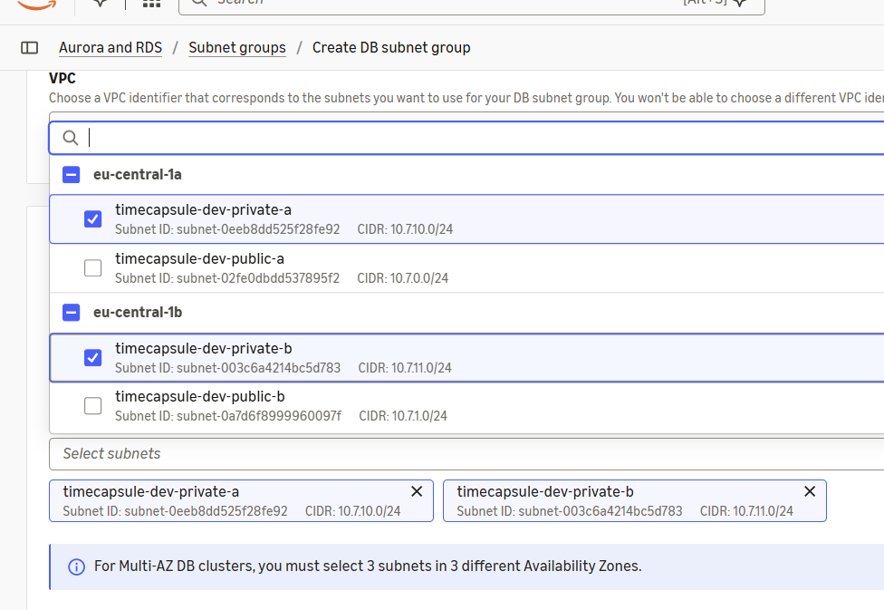

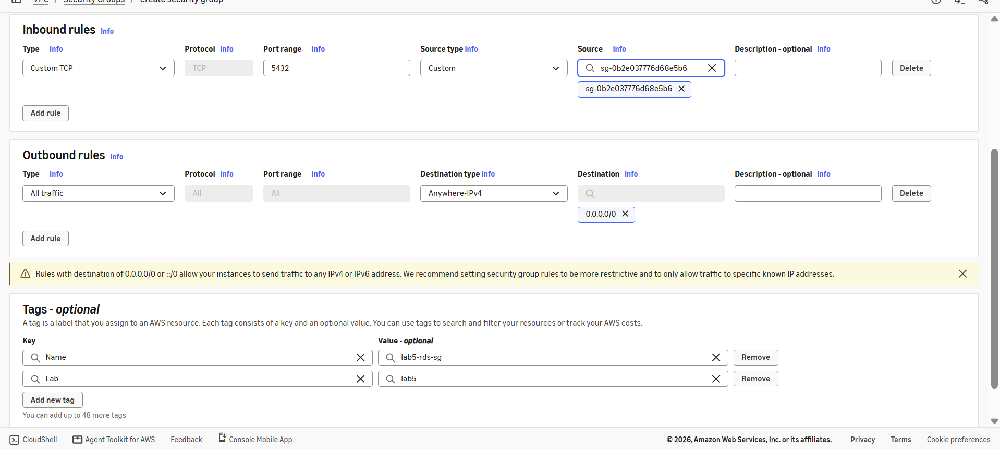

    1. Почему удобнее использовать Security Group источника, а не IP-адрес?

Security Group автоматически идентифицирует серверы приложения. Если IP-адрес EC2 изменится или сервер будет заменён, правила продолжат работать без изменений. Это упрощает управление доступом и повышает безопасность.

    2. Зачем указывать две подсети, если база будет работать в одной зоне?

Для отказоустойчивости и поддержки Multi-AZ. Если одна Availability Zone станет недоступна, RDS сможет разместить базу или резервный экземпляр в другой зоне. Это также обязательное требование для DB Subnet Group в нескольких сценариях RDS.

## Задание 2. База RDS

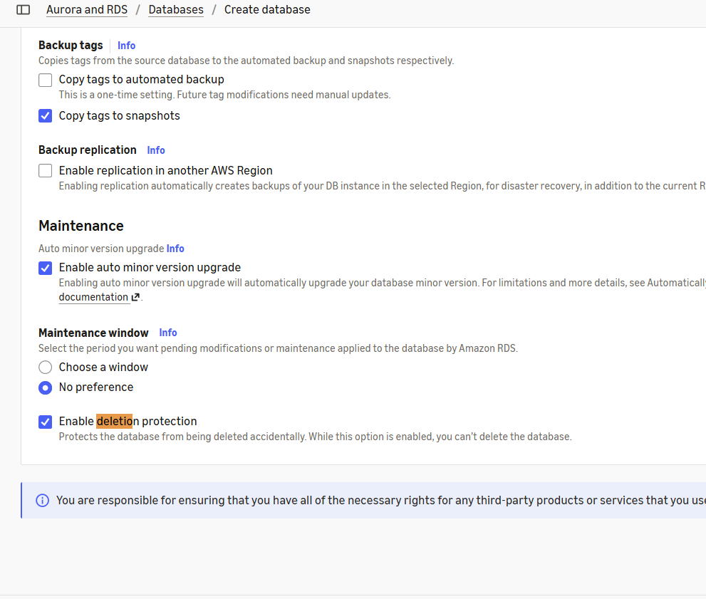

**Backup retention period** установлен `1 day` из-за ограничений плана.

1. Как убедиться, что база принимает подключения только с нужного сервера?

Проверить Security Group lab5-rds-sg. В Inbound Rules должно быть правило:
- Type: PostgreSQL
- Port: 5432
- Source: Security Group серверов приложения.
Подключение с других серверов будет заблокировано. Дополнительно Public Access должен быть установлен в No.

2. Почему выбрана зона eu-central-1a?

Это одна из зон доступности региона `Frankfurt (eu-central-1)`. Она обеспечивает размещение базы рядом с серверами приложения и уменьшает сетевую задержку. Вторая зона eu-central-1b добавлена в DB Subnet Group для возможности дальнейшей настройки отказоустойчивости.

3. От чего защищает Deletion Protection, а от чего нет?

- Защищает: от случайного удаления экземпляра RDS через AWS Console или API.

- Не защищает: от потери или повреждения данных, SQL-команд `DROP TABLE`, удаления записей, отказа оборудования и удаления резервных копий.
Для восстановления данных нужны резервные копии (Backups).

## Задание 3. Подключение к базе    

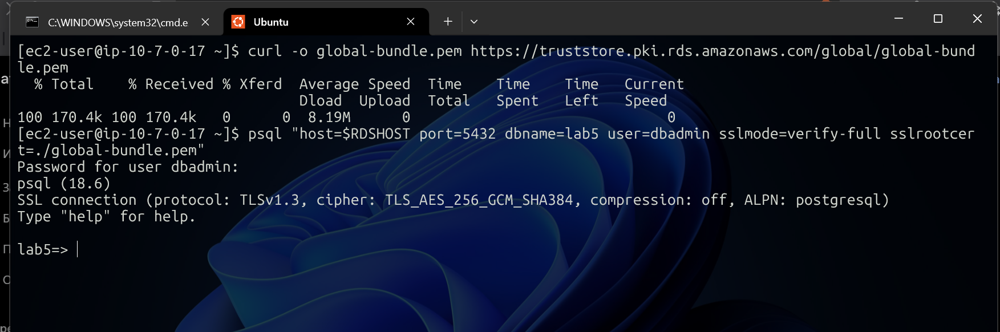

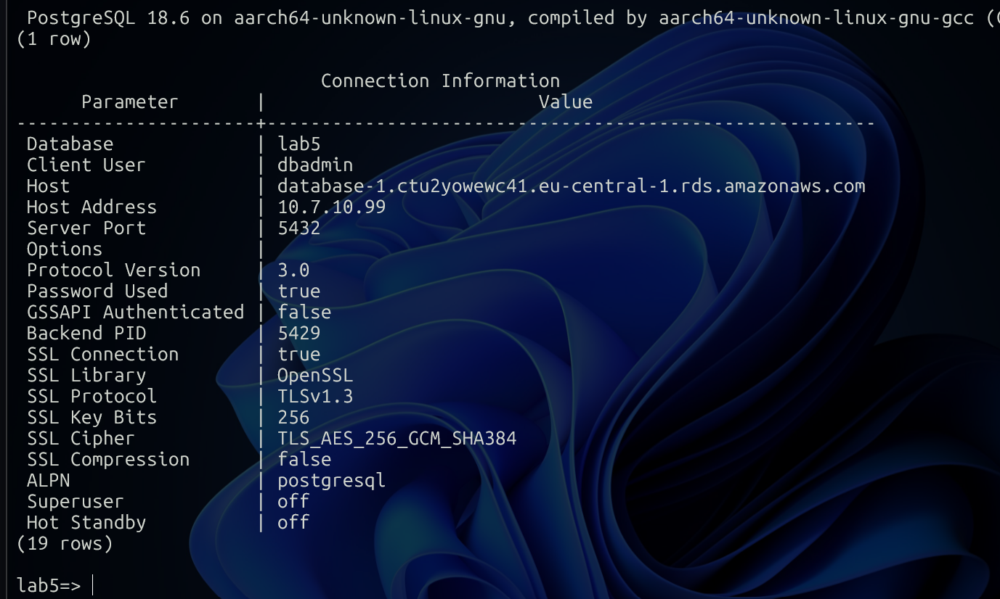

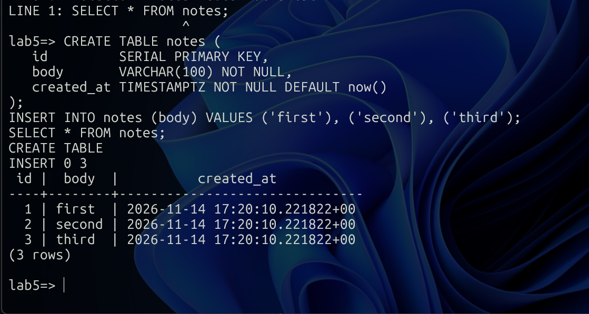

Server:         `10.7.0.2`

Address:        `10.7.0.2#53`

Non-authoritative answer:

Name:   database-1.ctu2yowewc41.

eu-central-1.rds.amazonaws.com

Address: `10.7.10.99`

**Endpoint:** `database-1.ctu2yowewc41.eu-central-1.rds.amazonaws.com`

IP-адрес: `10.7.10.99`

Тип адреса: приватный IPv4.

На домашнем компьютере DNS тоже разрешил Endpoint в 10.7.10.99.

    Результаты сравнения
    Где проверяли	IP-адрес
    EC2 (сервер приложения)	10.7.10.99
    компьютер (WSL)	10.7.10.99

**IP-адреса совпадают**

    Почему так получилось?
Твой компьютер использует DNS-сервер 10.255.255.254, который смог разрешить имя RDS в приватный IP.

Важно: разрешение DNS-имени не означает, что компьютер может подключиться к базе. Для подключения всё равно нужен сетевой маршрут в VPC и разрешённый доступ через Security Group.

## Задание 4. Реплика для чтения

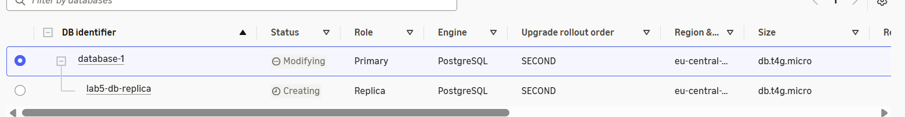

1. **Почему INSERT на реплике не выполнился?**

Read Replica предназначена для чтения данных (`SELECT`). Она получает изменения с основного экземпляра и работает в режиме только для чтения. Поэтому команды `INSERT`, `UPDATE` и `DELETE` на ней не выполняются.

2. **Чем Read Replica отличается от Multi-AZ?**

- **Read Replica** — копия базы для распределения нагрузки чтения. Может использоваться для выполнения `SELECT` и масштабирования приложения.
- **Multi-AZ** — резервный экземпляр для обеспечения отказоустойчивости. При сбое основного экземпляра AWS автоматически переключает работу на резервный.

**Главное отличие:** Read Replica повышает производительность чтения, а Multi-AZ обеспечивает доступность базы при сбоях.

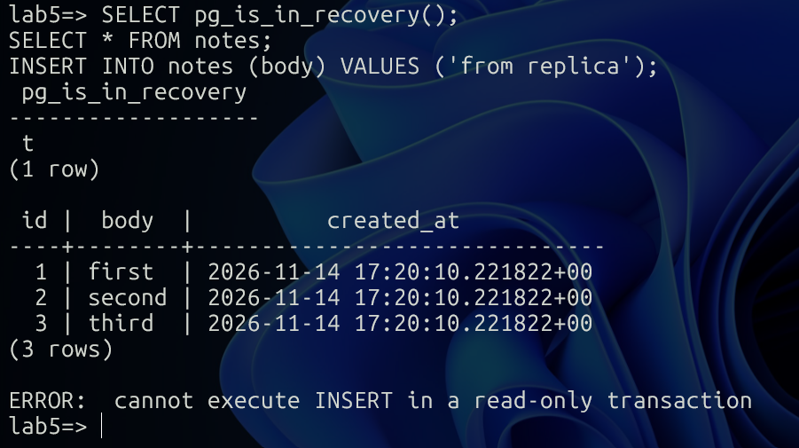

Результаты совпали с ожидаемыми:
Экземпляр	`pg_is_in_recovery()`	

Значение

Основная база database-1	f	Не находится в режиме восстановления

Read Replica	t	Находится в режиме восстановления

lab5=> INSERT INTO notes (body) VALUES ('fourth');
INSERT 0 1

 id |  body  |          created_at
----+--------+-------------------------------
  1 | first  | 2026-11-14 17:20:10.221822+00
  2 | second | 2026-11-14 17:20:10.221822+00
  3 | third  | 2026-11-14 17:20:10.221822+00
  4 | fourth | 2026-11-14 17:55:44.375711+00
(4 rows)

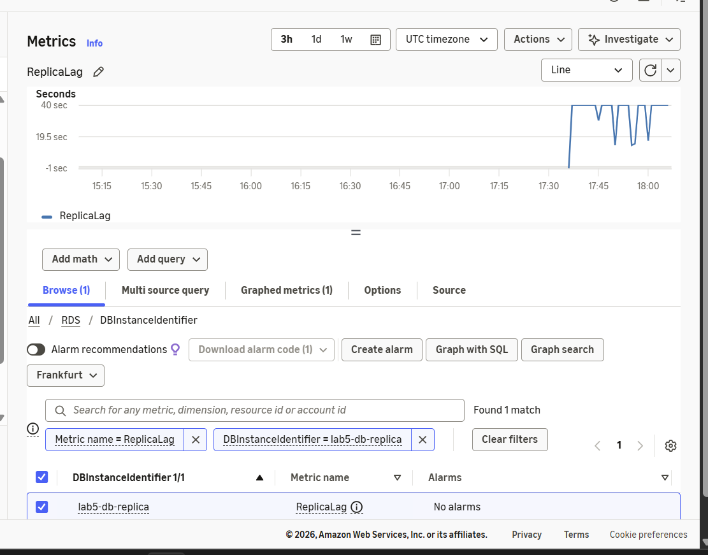

## Задание 5. Восстановление после ошибки

2026-11-14 18:12:11.040997

lab5=> DELETE FROM notes;
DELETE 4

Replica:
lab5=> SELECT * FROM notes;

 id | body | created_at
----+------+------------
(0 rows)

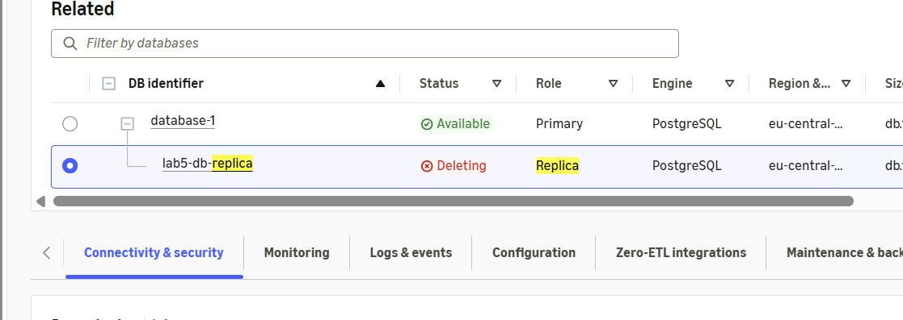

    Почему реплика не спасла данные? Почему восстановление создаёт новую базу, а не откатывает старую?

**1. Почему Read Replica не спасла данные?**

Read Replica предназначена для масштабирования чтения, а не для защиты от логических ошибок. Она автоматически копирует изменения основной базы, включая случайное удаление или изменение данных.

Поэтому если данные удалили на основной базе, удаление также распространится на реплику.

**2. Почему восстановление создаёт новую базу, а не откатывает старую?**

Amazon RDS создаёт отдельный экземпляр при восстановлении на определённый момент времени (Point-in-Time Recovery).

Это сделано для безопасности:

- Исходная база остаётся нетронутой.
- Можно проверить восстановленные данные.
- Можно перенести нужные данные обратно в основную базу.
- Снижается риск потери актуальных данных при ошибочном откате.

Read Replica обеспечивает масштабирование чтения, Multi-AZ — отказоустойчивость, а автоматические резервные копии и Point-in-Time Recovery позволяют восстановить данные после ошибок или случайного удаления.

### DB_RESTORE
 
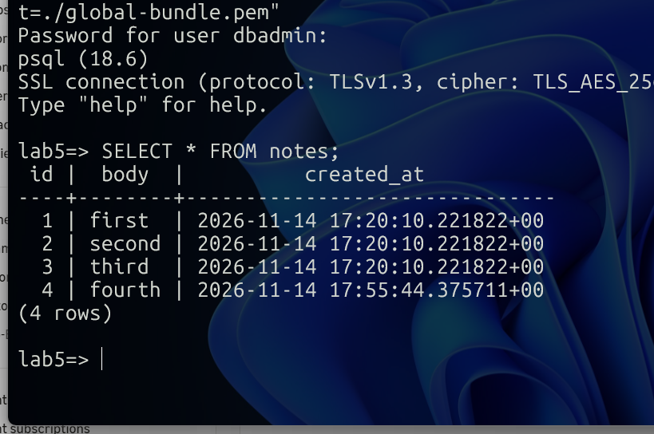

# Часть 2. Продвинутый уровень

## Задание 6. База приложения

    Какие параметры базы приложения вы выбрали бы иначе для рабочей системы с реальными пользователями? Почему?

## Задание 7. Ночная остановка базы

    Зачем расписанию своя роль, если вы и сами можете остановить базу? Почему роль может остановить только одну базу?

## Задание 8. Пользователь и база данных

    Почему приложению нужен отдельный пользователь, а не dbadmin?

## Задание 9. Перенос данных

## Задание 10. Переключение приложения

    Почему не пришлось менять DB_HOST? Какие обязанности из ЛР3 перешли к AWS, а какие остались за вами?

## Задание 11. Обслуживание базы

    Что показывал /health во время перезагрузки? Изменился ли endpoint после остановки и запуска? Какую ошибку получает расписание, если база уже остановлена?

## Задание 12. Архитектура и решение

# Контрольные вопросы

**1. Как проходит запрос от браузера до базы? Какие проверки проходит соединение на каждом шаге?**

1. Браузер отправляет HTTPS-запрос через DNS к Application Load Balancer (ALB).
2. ALB проверяет состояние целевых серверов (Health Check) и направляет запрос на работающий EC2.
3. EC2 проверяет запрос, авторизацию и обращается к базе данных.
4. Security Groups проверяют разрешённые подключения между серверами.
5. RDS проверяет доступность соединения, учётные данные и права пользователя, после чего выполняет SQL-запрос.

**2. Чем репликация отличается от резервного копирования?**

- **Репликация** — создание актуальной копии базы на другом сервере для повышения доступности и быстрого переключения при отказе.
- **Резервное копирование** — сохранение копий данных для восстановления после удаления, повреждения или ошибки.

**3. Как пережить отказ зоны eu-central-1a и сколько это будет стоить?**

Использовать Multi-AZ: разместить EC2 в нескольких Availability Zones, а RDS настроить с резервной репликой в другой зоне. При отказе eu-central-1a трафик переключится на работающие серверы, а RDS выполнит автоматический Failover. Стоимость увеличится из-за дополнительных ресурсов EC2 и RDS (примерно в 1,5–2 раза, в зависимости от конфигурации).

**4. Как вы решили проблему автоматического запуска базы через 7 дней?**

Настроили автоматизацию через AWS Lambda и EventBridge, которая проверяет состояние базы и запускает RDS после остановки. Учли ограничение AWS: RDS автоматически запускается после 7 дней непрерывной остановки.