# Лабораторная работа №6. Масштабирование и балансировка нагрузки. Elastic Load Balancing, Amazon EC2 Auto Scaling

## Kirov Kiril IA-2404

## Цель работы

Научиться распределять запросы между серверами с помощью `Application Load Balancer` и поручать `Amazon EC2 Auto Scaling` добавлять и убирать серверы по нагрузке.
Запустить приложение на нескольких серверах так, чтобы пользователь не терял вход, на какой бы сервер ни попал его запрос.

# Часть 1. Базовый уровень

## Задание 1. Балансировщик

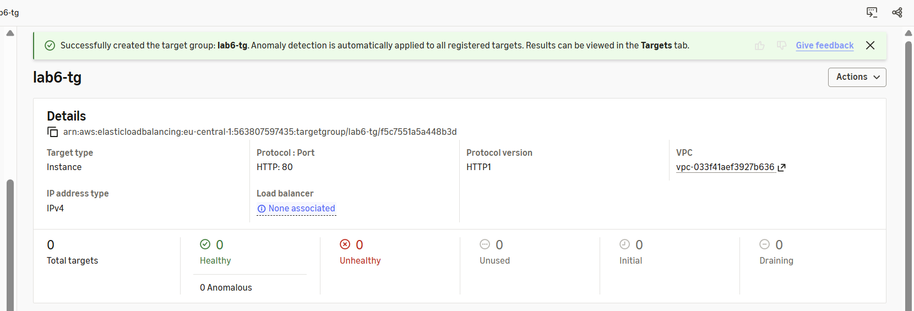                    

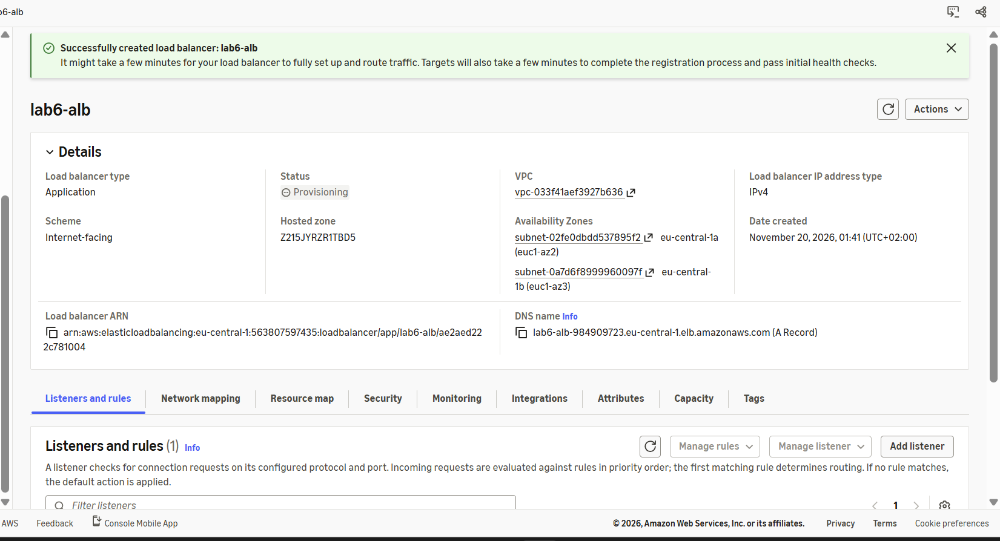

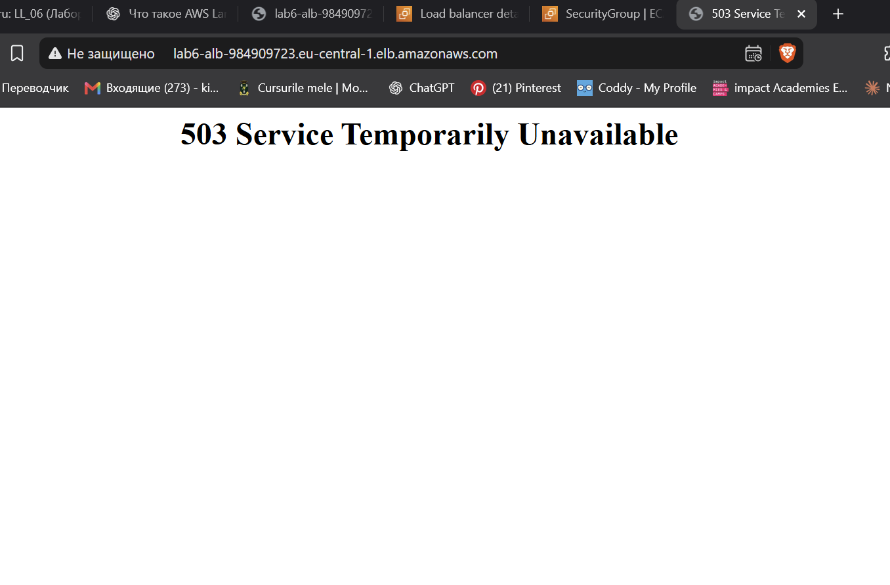

### **1. Какой ответ вернул балансировщик и почему?**

Балансировщик должен вернуть **HTTP 503 Service Temporarily Unavailable**.

Причина: Target Group `lab6-tg` пока не содержит зарегистрированных EC2-инстансов, которым можно передать запрос пользователя.

ALB принимает HTTP-запрос на порту 80, обращается к Target Group, но не находит доступных серверов для обработки запроса.

### **2. Зачем ему подсети в двух зонах доступности?**

Подсети в двух Availability Zones (AZ) нужны для **отказоустойчивости и высокой доступности (High Availability)**.

Например:

- `public-a` находится в Availability Zone A.
- `public-b` находится в Availability Zone B.

Если одна зона доступности перестанет работать, балансировщик сможет продолжить принимать запросы через другую зону.

Дополнительные преимущества:

- Распределение нагрузки между зонами.
- Уменьшение риска простоя приложения.
- Возможность размещать EC2-инстансы в разных зонах.

## Задание 2. Группа Auto Scaling

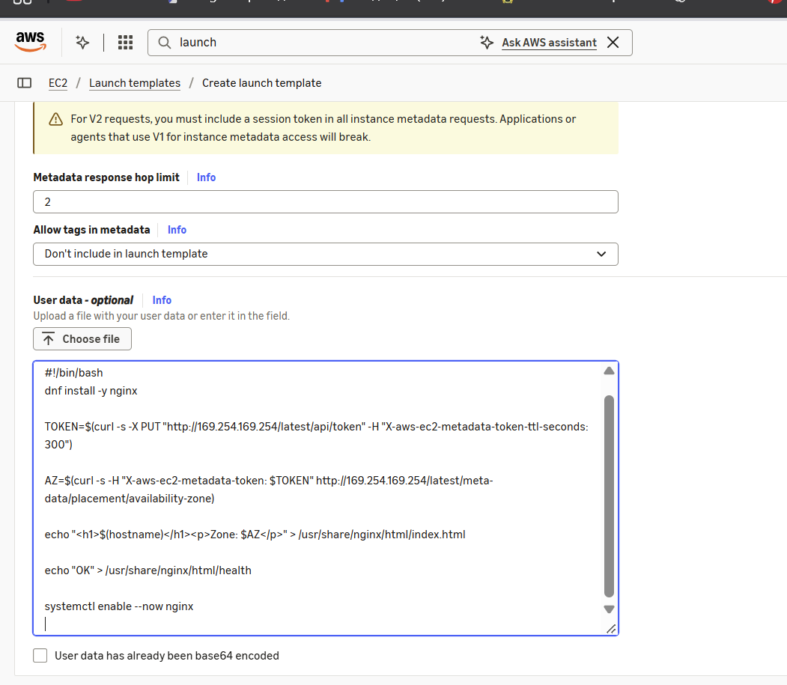

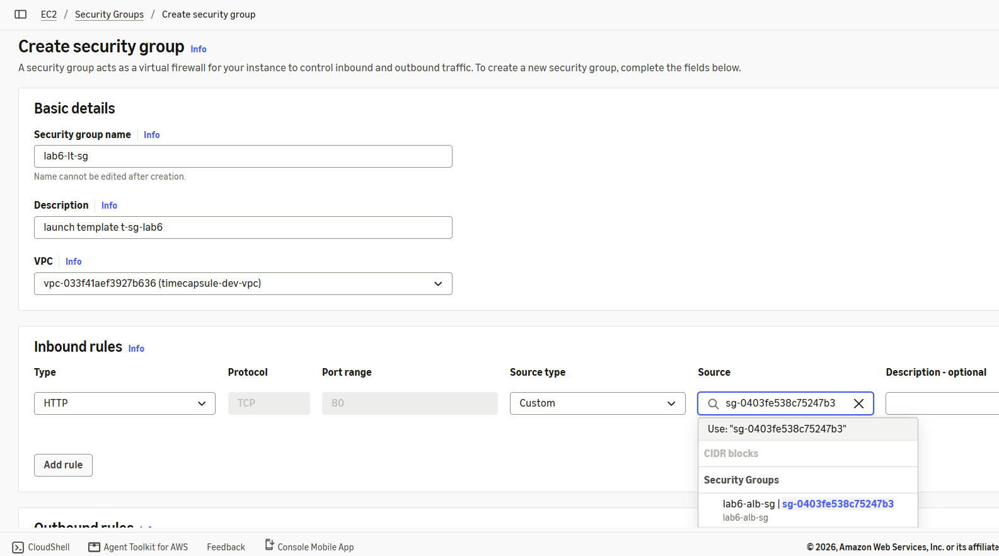

Что делает этот скрипт:
1. `dnf install -y nginx` — устанавливает веб-сервер Nginx.
2. `TOKEN` — получает токен IMDSv2 для доступа к метаданным EC2.
3. `AZ` — получает Availability Zone сервера.
4. `echo` — создаёт HTML-страницу с именем сервера и его зоной.
5. Создаёт `/health`, который будет использовать Target Group для проверки работоспособности.
6. Запускает Nginx и включает его автоматический запуск при загрузке.

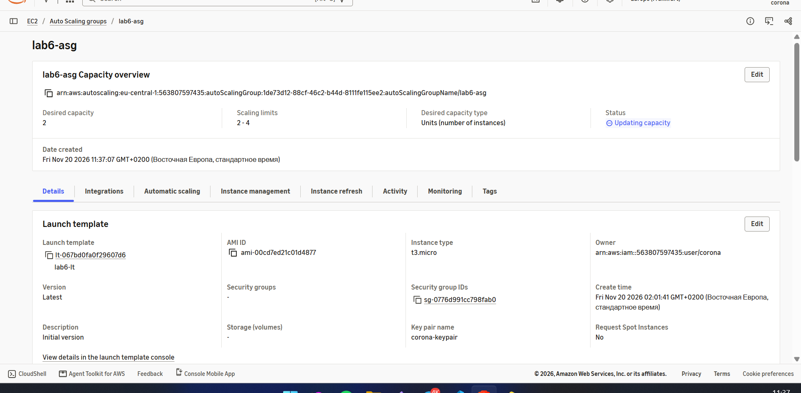

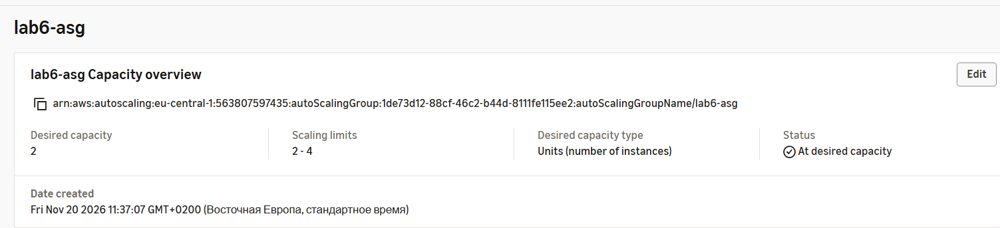

## **1. Auto Scaling Group vs Target Group**

**Auto Scaling Group (ASG)** — управляет количеством EC2-инстансов: создаёт, удаляет и заменяет серверы в зависимости от заданных условий.

**Target Group (TG)** — определяет, каким серверам балансировщик может передавать запросы.

| Характеристика  | Auto Scaling Group               | Target Group                     |
| --------------- | -------------------------------- | -------------------------------- |
| Назначение      | Управление серверами             | Распределение запросов           |
| Создаёт EC2     | Да                               | Нет                              |
| Удаляет EC2     | Да                               | Нет                              |
| Health checks   | Контролирует состояние инстансов | Проверяет доступность приложения |
| Масштабирование | Да                               | Нет                              |
| Связь с ALB     | Через Target Group               | Получает запросы от ALB          |

### **Как они работают вместе?**

1. Auto Scaling Group запускает EC2-инстансы.
2. Автоматически регистрирует их в Target Group.
3. ALB проверяет работоспособность серверов.
4. ALB распределяет запросы между здоровыми серверами.
5. Если ASG создаёт новый сервер, он также добавляется в Target Group.

## **2. Почему в Launch Template нет подсети?**

Потому что **Launch Template (шаблон запуска)** описывает конфигурацию создаваемого EC2-инстанса, а не место его размещения.

В Launch Template указываются:

- AMI (образ операционной системы).
- Instance Type (например, t2.micro).
- Key Pair.
- Security Groups.
- Storage.
- User Data (скрипт автоматической настройки сервера).

А вот подсети задаются непосредственно в **Auto Scaling Group**.

## Задание 3. Нагрузка

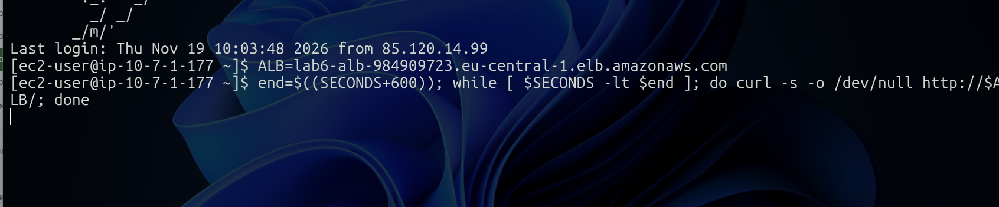

С двух машин поднялось до 3

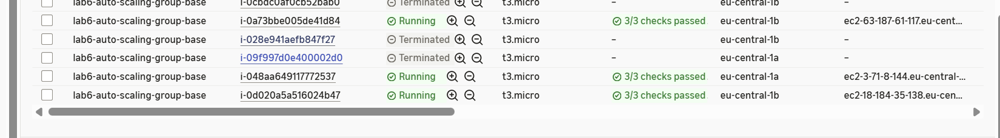

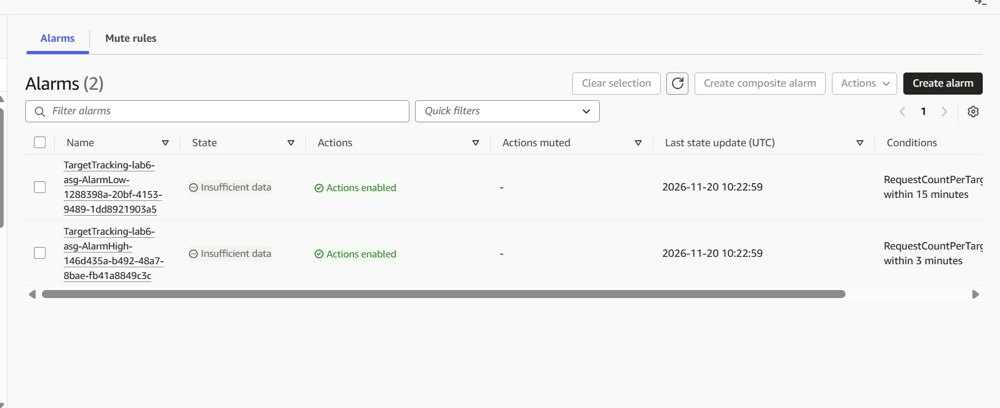

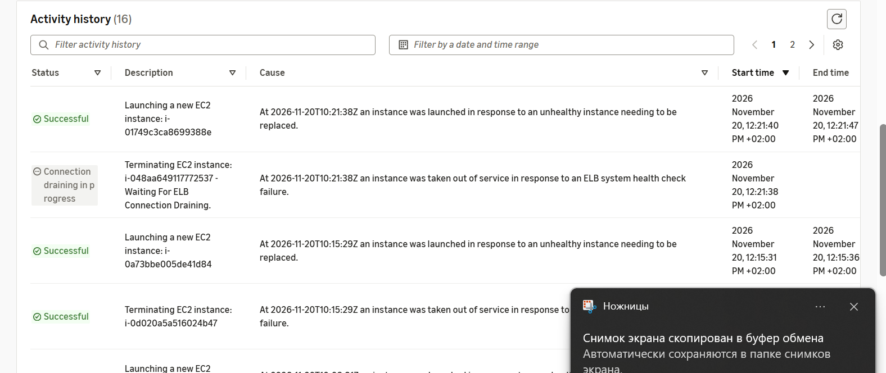

### **1. Сколько серверов запустила группа и почему не больше четырёх?**

Группа Auto Scaling запустила дополнительные EC2-инстансы в ответ на увеличение нагрузки.

Максимальное количество серверов ограничено параметром **Max capacity = 4**. Поэтому даже если нагрузка продолжает расти, Auto Scaling Group не запустит больше четырёх экземпляров.

### **2. Почему метрика упала после запуска новых серверов, хотя запросов не стало меньше?**

Потому что используется метрика `ALBRequestCountPerTarget` — количество запросов на одну цель.

Когда запускаются дополнительные серверы, балансировщик распределяет запросы между большим количеством целей.

### **3. Почему группа добавляет серверы быстрее, чем убирает?**

Это связано с особенностями Target Tracking Scaling Policy.

- **Scale-out (увеличение):** группа быстрее запускает новые серверы, чтобы не допустить перегрузки существующих экземпляров.
- **Scale-in (уменьшение):** происходит осторожнее, чтобы избежать постоянного запуска и остановки серверов при небольших колебаниях нагрузки.

Кроме того, AWS использует разные CloudWatch Alarms для масштабирования вверх и вниз, а для уменьшения количества серверов применяет защитные интервалы и временные задержки.

Это помогает поддерживать стабильность приложения и избегать резких изменений количества серверов.

# Часть 2. Продвинутый уровень

## Задание 4. Сессии в DynamoDB

    Почему сессии нельзя оставить в файлах, когда серверов несколько? Зачем Node.js нужен initialized: true?

## Задание 5. Приложение в группе Auto Scaling

    Почему Elastic IP больше не нужен? Почему у всех серверов группы одинаковые .env и секреты? Что станет с проверкой /health, если базу остановить?

## Задание 6. Нагрузка на приложение

    Пришлось ли входить заново, когда группа добавляла или удаляла серверы? Почему?

## Задание 7. Архитектура и решение

## Контрольные вопросы

### **1. Как проходит запрос от браузера до базы и таблицы сессий?**

1. Браузер отправляет HTTP-запрос.
2. **Load Balancer (ALB)** принимает запрос и направляет его на доступный EC2.
3. EC2 обрабатывает запрос через приложение.
4. Приложение обращается к **RDS** для получения или изменения данных.
5. Данные сессии хранятся в общей базе данных, поэтому доступны всем серверам.
6. Результат возвращается через Load Balancer в браузер.

### **2. Чем проверка балансировщика отличается от проверки группы Auto Scaling?**

- **Load Balancer Health Check** проверяет доступность приложения на EC2 и перестаёт направлять запросы на неисправные экземпляры.
- **Auto Scaling Health Check** проверяет состояние EC2 и при обнаружении неисправности может заменить экземпляр новым.

### **3. Что произойдёт при отказе зоны eu-central-1a?**

- Load Balancer перестанет направлять запросы в неисправную зону.
- Auto Scaling запустит новые EC2 в доступной зоне, если это предусмотрено конфигурацией.
- RDS Multi-AZ переключится на резервную базу данных.
- Пользователи смогут продолжить работу через оставшуюся доступную зону.

**Итог:** система сохраняет работоспособность благодаря распределению серверов и резервированию базы данных между зонами доступности.