# Лабораторная работа №7. Бессерверные вычисления и события. AWS Lambda, Amazon SQS, Amazon SNS

## Цель работы:

Научиться связывать части системы через тему Amazon SNS и очередь Amazon SQS и обрабатывать сообщения функциями AWS Lambda. Затем вынести из веб-запросов приложения медленную и фоновую работу: отправку писем и открытие капсул по времени.

# Часть 1. Базовый уровень

## Задание 1. Тема и очередь отзывов

Создал стандартную тему, 2 очереди, и подписал queue на topic

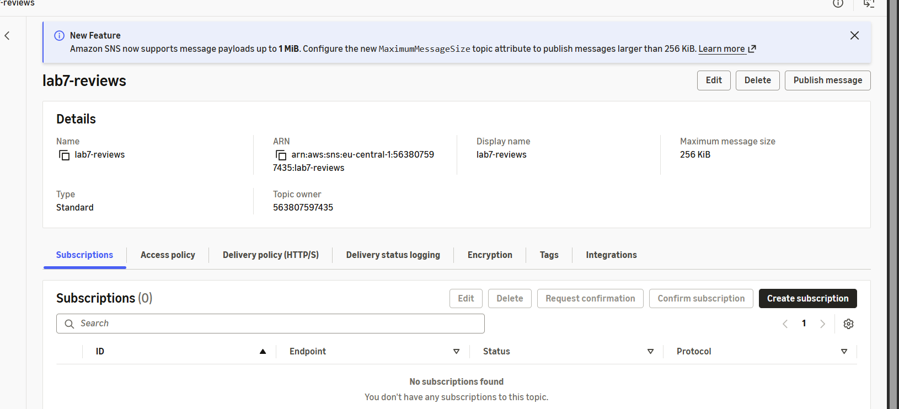

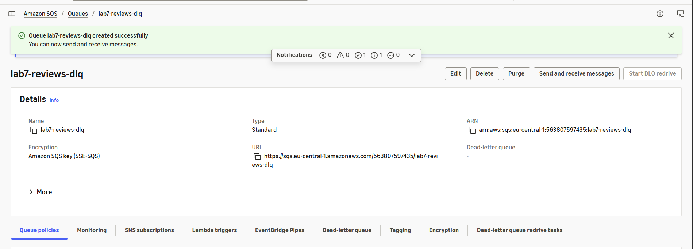

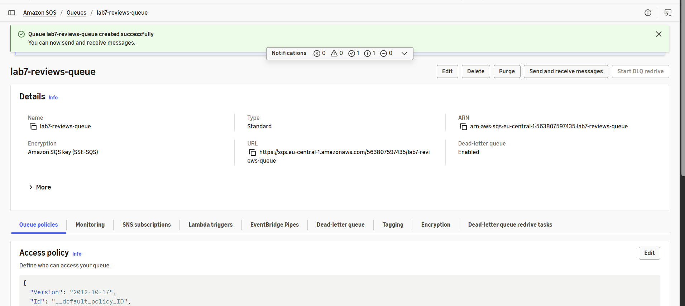

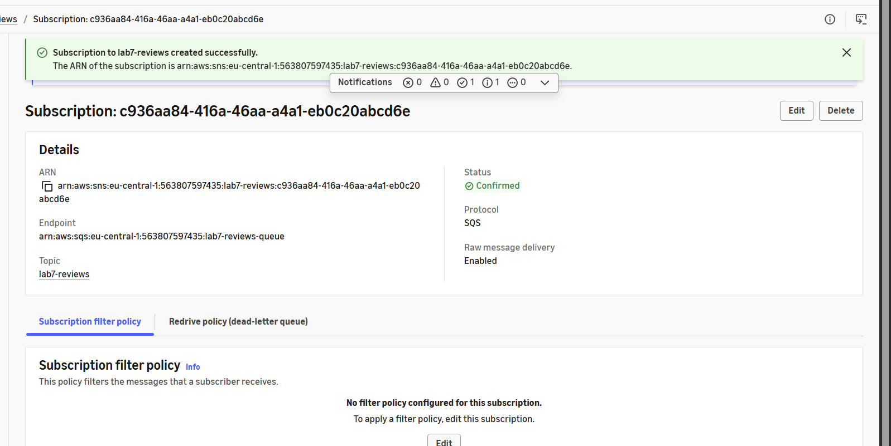

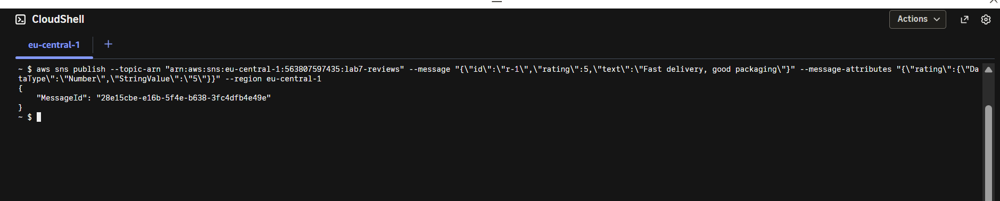

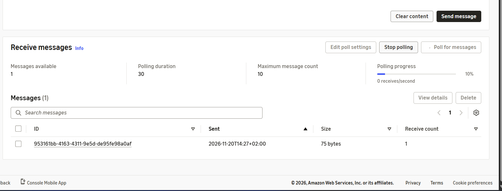

Для основной очереди lab7-reviews-queue я выбрал следующие настройки:

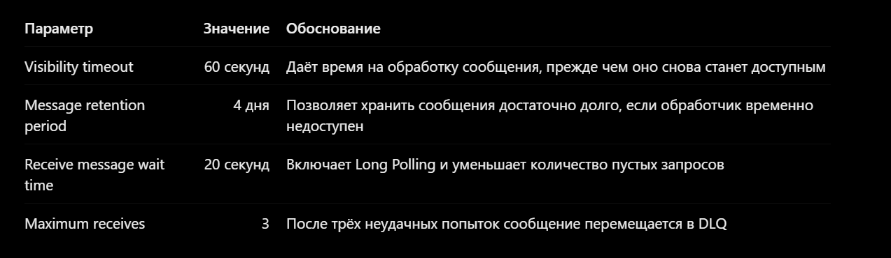

Для очереди lab7-reviews-dlq оставлены стандартные настройки.
2. Как выглядит тело сообщения с Raw message delivery и без него?
С включённым Raw message delivery (Enabled):

В очередь поступает непосредственно исходное сообщение:
```json
{
  "id": "r-1",
  "rating": 5,
  "text": "Fast delivery, good packaging"
}
```

С выключенным Raw message delivery (Disabled):

SNS добавляет собственную JSON-обёртку с метаданными:
```json
{
  "Type": "Notification",
  "MessageId": "...",
  "TopicArn": "arn:aws:sns:eu-central-1:563807597435:lab7-reviews",
  "Message": "{\"id\":\"r-1\",\"rating\":5,\"text\":\"Fast delivery, good packaging\"}",
  "Timestamp": "...",
  "SignatureVersion": "1",
  "Signature": "...",
  "SigningCertURL": "...",
  "UnsubscribeURL": "..."
}
```

3. Почему сообщение снова видно в очереди через некоторое время?
Это связано с параметром `Visibility Timeout`.

Когда сообщение получают из SQS, оно не удаляется из очереди, а временно становится невидимым для других потребителей.

Если за установленное время сообщение не удалить с помощью `DeleteMessage`, по истечении `Visibility Timeout` оно снова становится доступным для получения.

Например:
1. Получили сообщение из очереди.
2. Оно стало невидимым на 60 секунд.
3. Не удалили его из очереди.
4. Через 60 секунд оно снова появилось при Poll for messages.

Это механизм повторной доставки `(At-Least-Once Delivery)`, который позволяет не потерять сообщения, если обработчик завершился с ошибкой или не успел выполнить обработку.

## Задание 2. Обработчик отзывов

```json
{
  "id": "r-1",
  "rating": 5,
  "text": "Fast delivery, good product and excellent service"
}
```

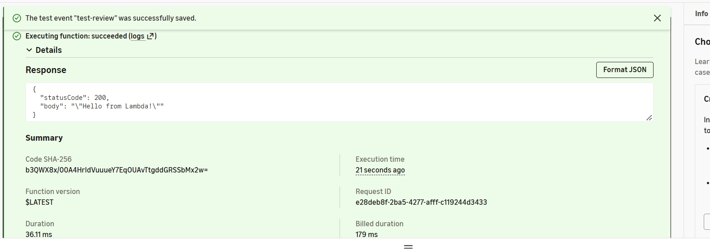

```js

export const handler = async (event) => {
  for (const record of event.Records) {
      const review = JSON.parse(record.body);

      const id = review.id;
      const rating = review.rating;
      const text = review.text;

      const preview = text.substring(0, 20);

      console.log(`${id}: ${rating}/5 ${preview}`);
  }
};

```
Этот код получает отзыв, извлекает его ID, оценку и первые 20 символов текста через функцию substring(), после чего записывает эту информацию в CloudWatch Logs.


```js
[tls-profile] applied 'aws' -> /var/runtime/tls-profiles/commercial-2025.conf
START RequestId: 99d71fd0-c74f-41e9-9997-215b77ebd8c4 Version: $LATEST
2026-11-20T13:58:52.225Z	99d71fd0-c74f-41e9-9997-215b77ebd8c4

INFO
r-1: 5/5 Fast delivery, good 

END RequestId: 99d71fd0-c74f-41e9-9997-215b77ebd8c4
REPORT RequestId: 99d71fd0-c74f-41e9-9997-215b77ebd8c4	Duration: 78.47 ms	Billed Duration: 220 ms	Memory Size: 128 MB	Max Memory Used: 79 MB	Init Duration: 141.19 ms	
```

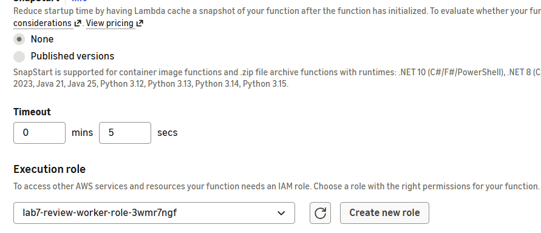

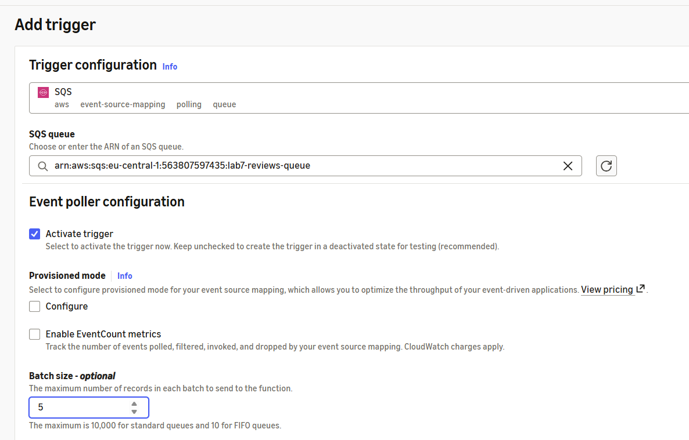

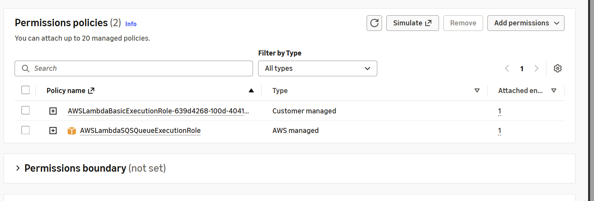

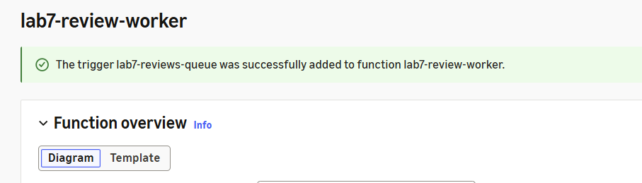

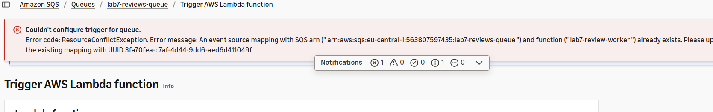

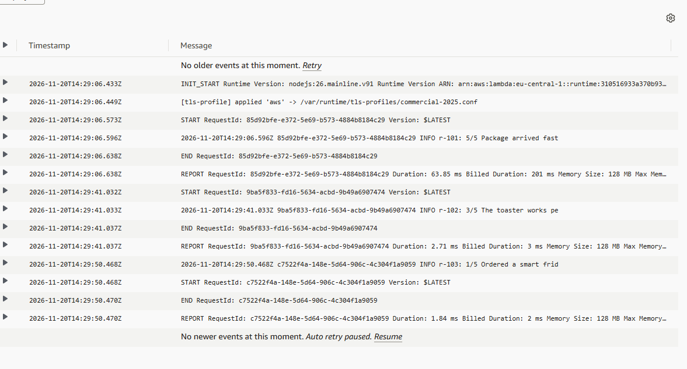

1. Результаты обработки

**ID отзыва**	Оценка	Вывод Lambda

**r-101**	`5/5`	Package arrived fast

**r-102**	`3/5`	The toaster works pe

**r-103**	`1/5`	Ordered a smart frid

Для трёх отзывов при Batch size = 5 обычно достаточно одного вызова Lambda.

Это зависит от следующих факторов:
- Batch size — максимальное количество сообщений, которое Lambda может получить за один вызов. У нас это 5.
- Количество сообщений — у нас 3 отзыва, поэтому они помещаются в одну пачку.
- Время поступления сообщений — если сообщения приходят с большими интервалами, Lambda может обработать их отдельными вызовами, не дожидаясь заполнения пачки.
- Настройки Event Source Mapping — влияют на сбор и передачу сообщений Lambda.


## Задание 3. Отзыв, который не удалось обработать


## Задание 4. Плохие отзывы на почту


# Часть 2. Продвинутый уровень


## Задание 5. Очередь писем и событие о запечатывании


## Задание 6. Lambda-функция писем


## Задание 7. Публикация событий из приложения


## Задание 8. Открытие капсул по расписанию


## Задание 9. Сбой обработчика


## Задание 10. Архитектура и решение